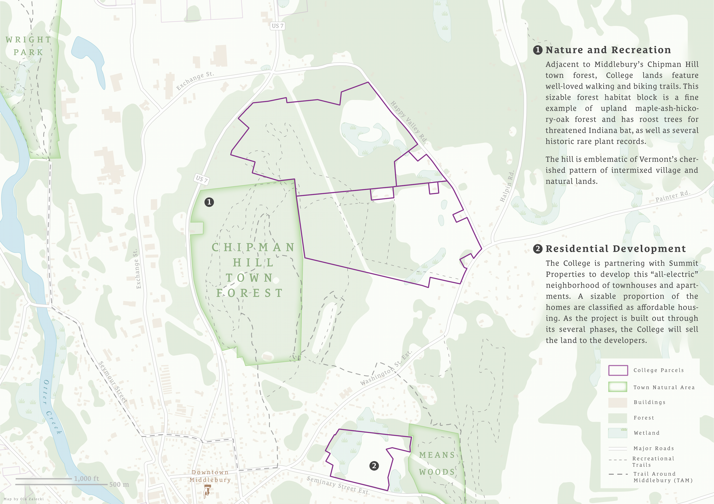
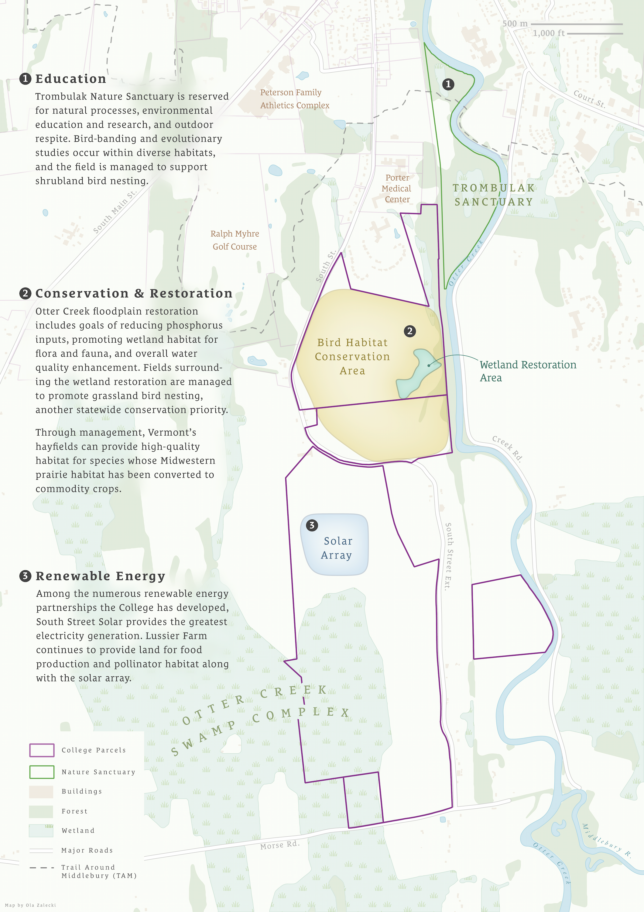
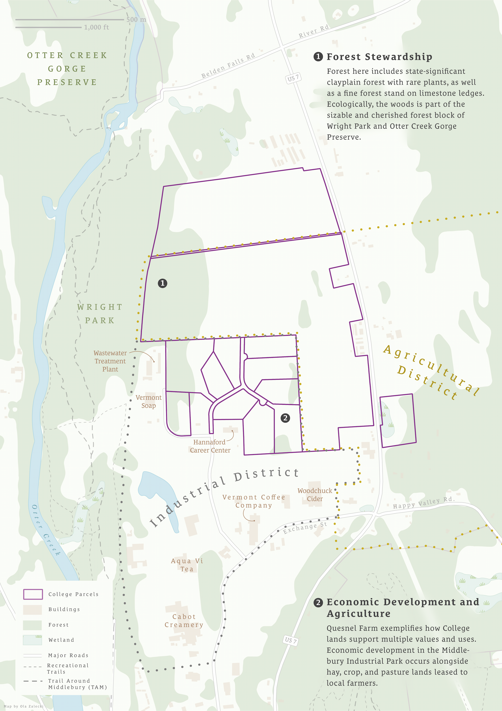
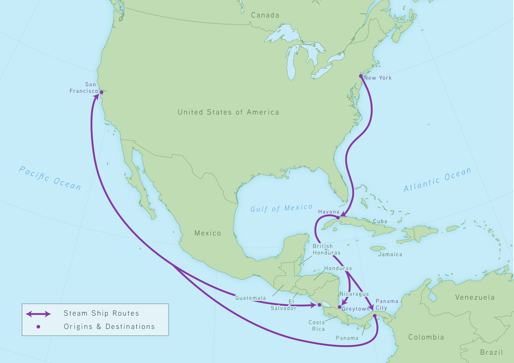
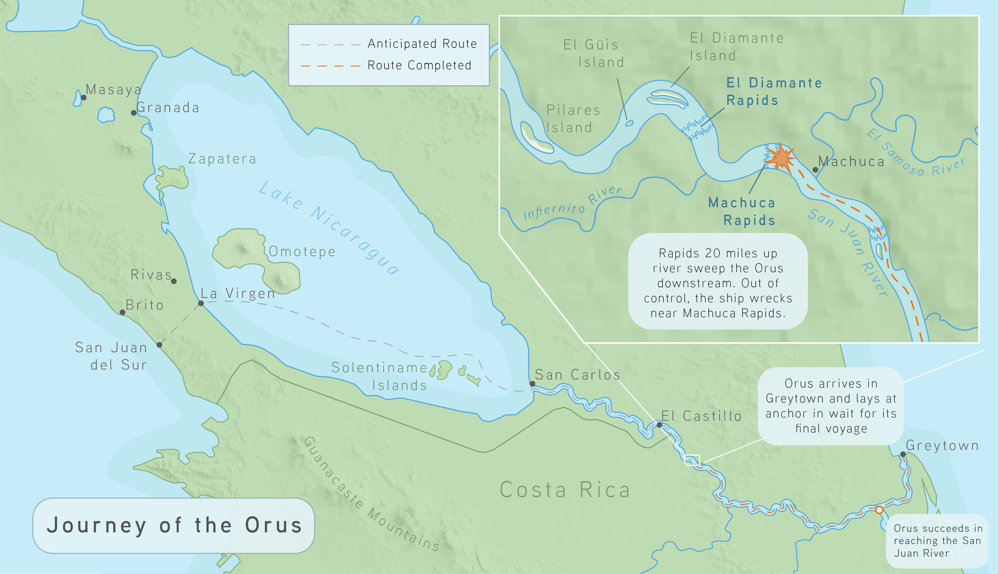
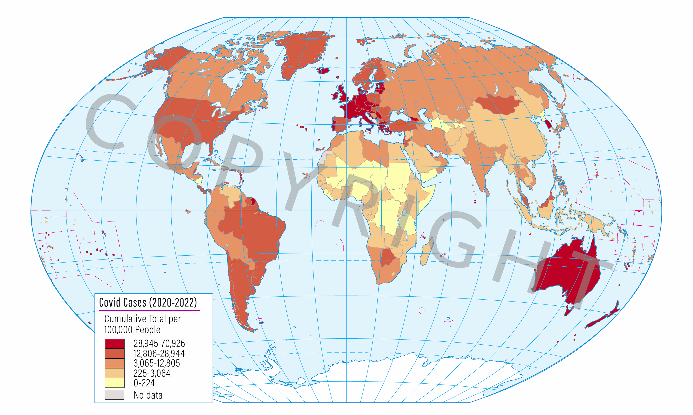
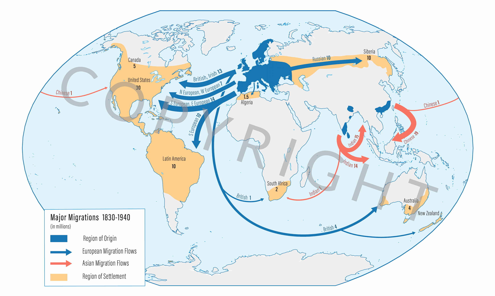
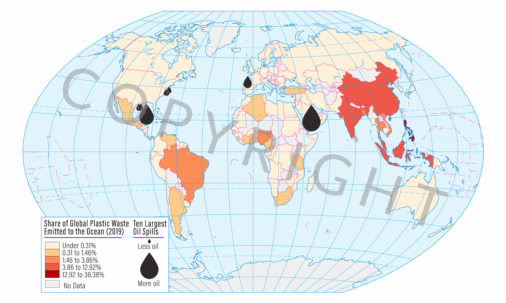
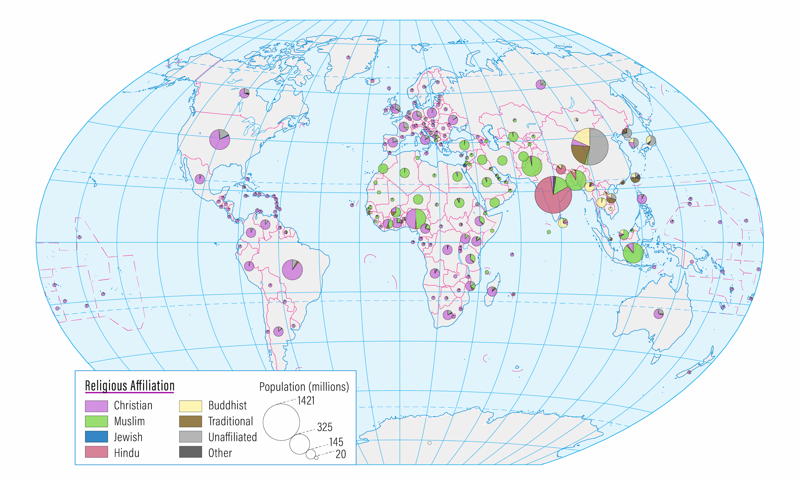

<link rel="stylesheet" href="https://unpkg.com/photoswipe@5/dist/photoswipe.css">
<link rel="stylesheet" href="https://unpkg.com/photoswipe-dynamic-caption-plugin/photoswipe-dynamic-caption-plugin.css">

## Mapping Middlebury College Lands

  <a href="/assets/img/collegelands/ChipmanHill_medium.png"
     data-pswp-width="3000" data-pswp-height="2120" data-cropped="true"
     target="_blank">
    
    
      <strong>Image 4 title</strong> Caption text here.
    
  </a>

  <a href="/assets/img/collegelands/_medium_.png"
     data-pswp-width="2120" data-pswp-height="3000" data-cropped="true"
     target="_blank">
    
    
      <strong>Image 4 title</strong> Caption text here.
    
  </a>

  <a href="/assets/img/collegelands/QuesnelFarm_medium.png"
     data-pswp-width="2120" data-pswp-height="3000" data-cropped="true"
     target="_blank">
    
    
      <strong>Image 4 title</strong> Caption text here.
    
  </a>

## American Steamboats in Nicaragua

  <a href="/assets/img/shipwrecks/NicaraguaRoute.png"
     data-pswp-width="3509" data-pswp-height="2480" data-cropped="true"
     target="_blank">
    
    
      <strong>Image 1 title</strong> Caption text here.
    
  </a>

  <a href="/assets/img/shipwrecks/RioSanJuan.png"
     data-pswp-width="3334" data-pswp-height="1917" data-cropped="true"
     target="_blank">
    
    
      <strong>Image 2 title</strong> Caption text here.
    
  </a>

## Atlas of Globalization

The [Middlebury Atlas of Globalization](https://www.langenscheidt.com/shop/englisch/middlebury-atlas-of-globalization-SW50013?srsltid=AfmBOoqcND4qE6kT0WviLjYcHgRB_k4lP0jtJYCV7HFWz9MuA521LBOc) is an atlas textbook for college level introductory courses in international and global studies. The atlas was authored by three Middlebury College professors and explores the process of globalization through various academic disciplines like history, political science and environmental studies. The atlas includes over 100 maps, atleast 50 of which I had the pleasure of helping produce. 

I joined the "Global Atlas Team" as a cartographer/research assistant tasked with exploring and mapping topics such as military spending, flows of capital, religious affiliation. Below is a selection of some of the maps I contributed to.

  <a href="/assets/img/atlas/covidcases_medium.png"
     data-pswp-width="2000" data-pswp-height="3000" data-cropped="true"
     target="_blank">
    
    
      <strong>Image 4 title</strong> Caption text here.
    
  </a>

  <a href="/assets/img/atlas/euromigration_medium.png"
     data-pswp-width="2000" data-pswp-height="3000" data-cropped="true"
     target="_blank">
    
    
      <strong>Image 4 title</strong> Caption text here.
    
  </a>

  <a href="/assets/img/atlas/waterpollution_medium.png"
     data-pswp-width="2000" data-pswp-height="3000" data-cropped="true"
     target="_blank">
    
    
      <strong>Image 4 title</strong> Caption text here.
    
  </a>

  <a href="/assets/img/atlas/religion_medium.png"
     data-pswp-width="2000" data-pswp-height="3000" data-cropped="true"
     target="_blank">
    
    
      <strong>Image 4 title</strong> Caption text here.
    
  </a>

