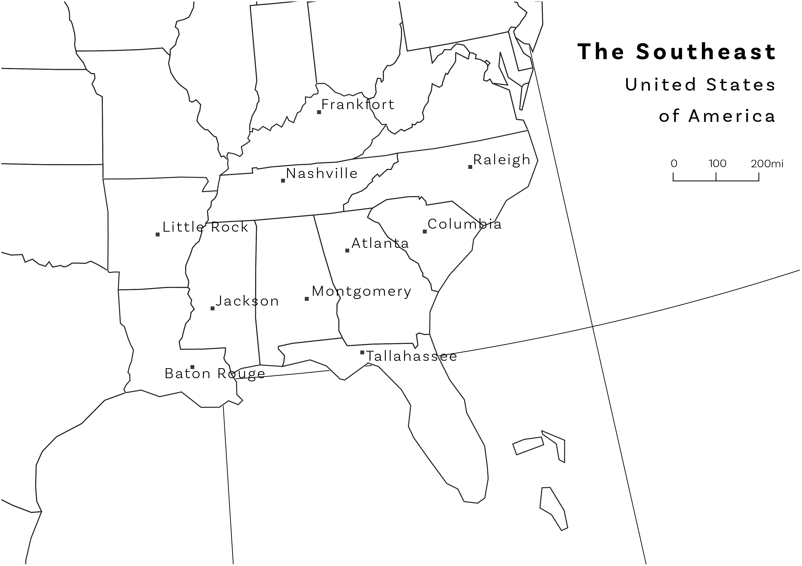
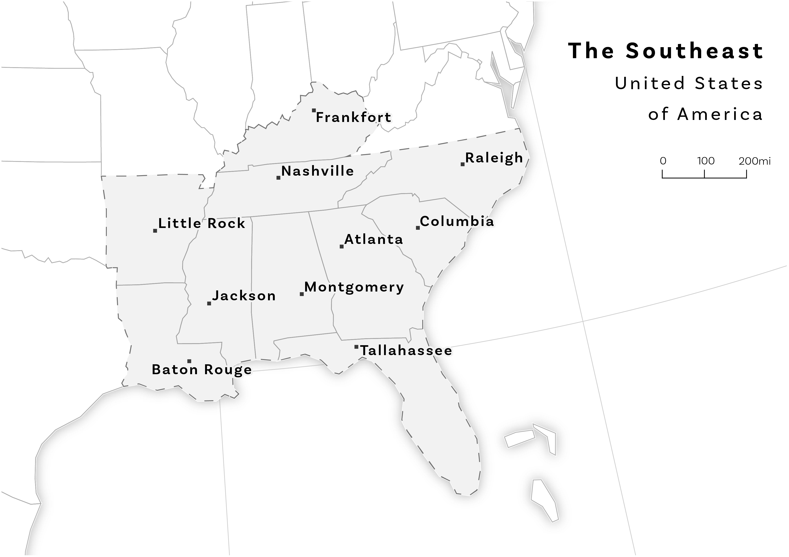
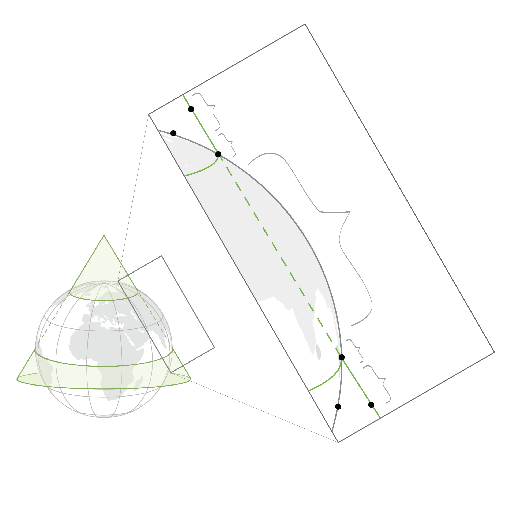
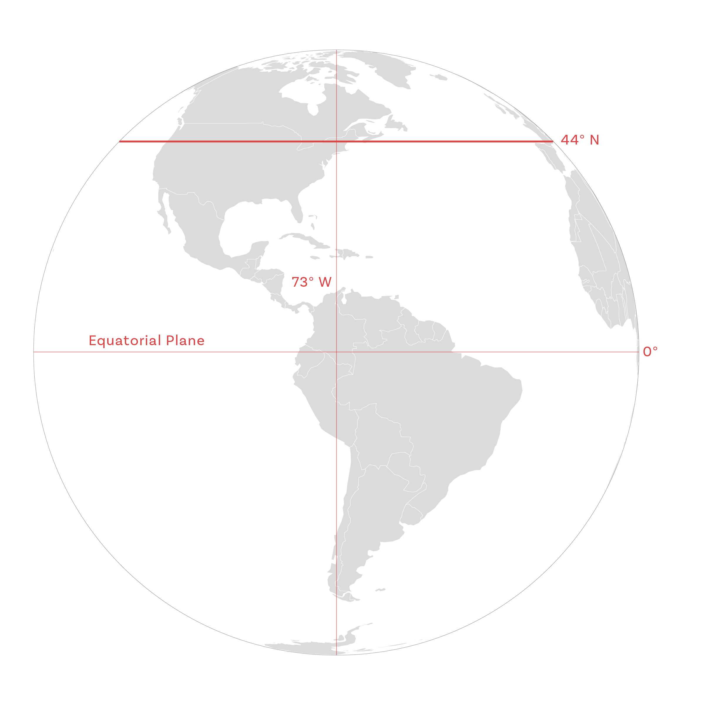
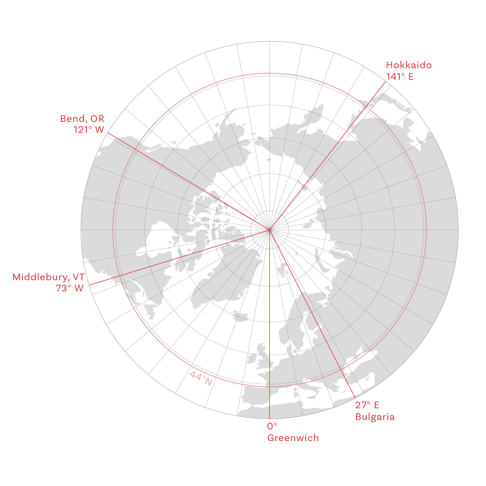
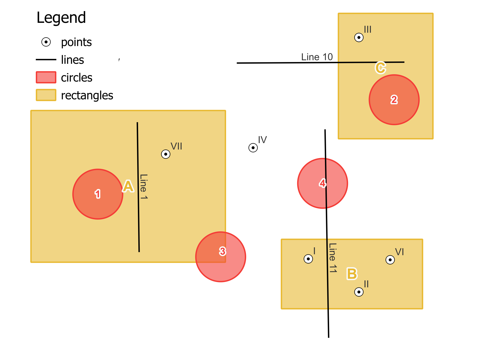
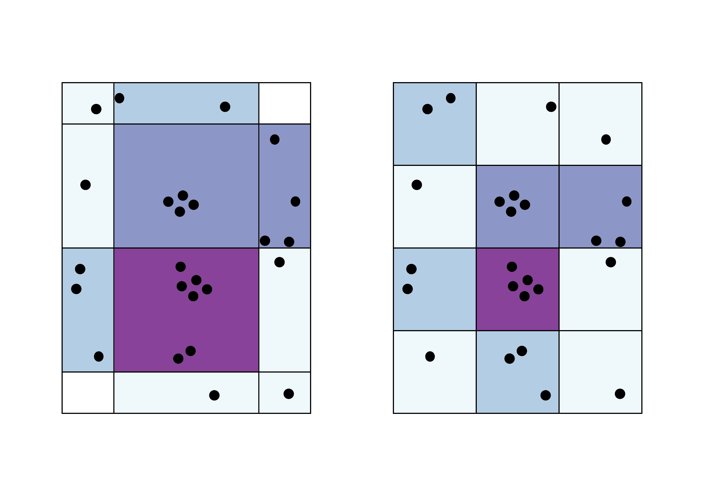
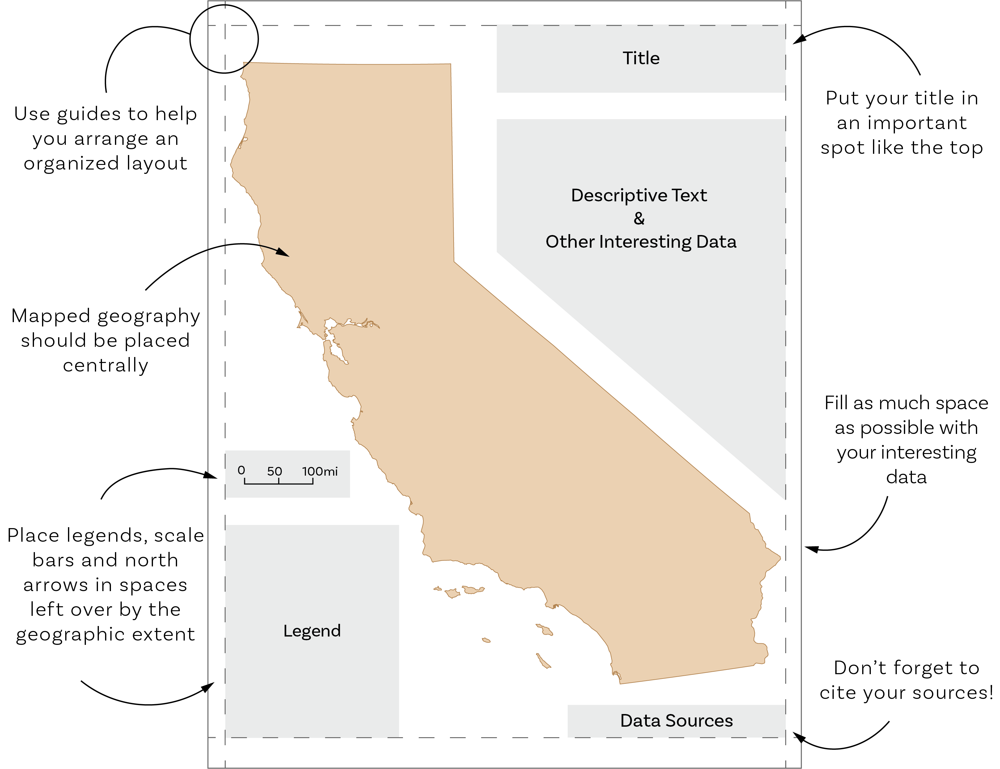

Teaching GIS concepts often requires visuals. Sometimes those visuals don't exist on line and if they do they might be proprietary. One of the roles that I picked up in recent years has been illustrating certain concepts that we can't find visuals for or that are unique to the way that we teach GIS. Below you will find a selection of some of the illustrations and maps that I have produced for the course Human Geography with GIS: GEOG0261. Some of these illustrations live in our course manual while others in lab handouts, question sets, slides, etc. Some illustrations are used for exams and other assessments that I cannot freely distribute. For a full selection, please email me! 

<link rel="stylesheet" href="https://unpkg.com/photoswipe@5/dist/photoswipe.css">
<link rel="stylesheet" href="https://unpkg.com/photoswipe-dynamic-caption-plugin/photoswipe-dynamic-caption-plugin.css">

  <a href="/assets/img/gisart/badFG.png"
     data-pswp-width="3509"
     data-pswp-height="2480"
     target="_blank">
    
    
      <strong>Bad Example of Figure Ground</strong> 
      Your caption text here: what the map shows, data sources, tools used.
    
  </a>

  <a href="/assets/img/gisart/goodFG.png"
     data-pswp-width="3509"
     data-pswp-height="2480"
     target="_blank">
     
    
      <strong>Good Example of Figure Ground</strong> 
      Your caption text here: what the map shows, data sources, tools used.
    
  </a>

  <a href="/assets/img/gisart/projected_multi_panel.png"
     data-pswp-width="2400"
     data-pswp-height="1280"
     target="_blank">
    
    
      <strong>Multi Panel Projection Layout</strong> 
      Your caption text here: what the map shows, data sources, tools used.
    
  </a>

  <a href="/assets/img/gisart/Dev_Surf_Secant.png"
     data-pswp-width="2400"
     data-pswp-height="2400"
     target="_blank">
    
    
      <strong>Developable Surface of a Secant Case</strong> 
      Your caption text here: what the map shows, data sources, tools used.
    
  </a>

  <a href="/assets/img/gisart/measureLat.png"
     data-pswp-width="2400"
     data-pswp-height="2400"
     target="_blank">
     
    
      <strong>Measuring Latitude</strong> 
      Your caption text here: what the map shows, data sources, tools used.
    
  </a>

  <a href="/assets/img/gisart/measureLong.png"
     data-pswp-width="2400"
     data-pswp-height="2400"
     target="_blank">
    
    
      <strong>Measuring Latitude</strong> 
      Your caption text here: what the map shows, data sources, tools used.
    
  </a>

  <a href="/assets/img/gisart/overlays_all.png"
     data-pswp-width="2100"
     data-pswp-height="1500"
     target="_blank">
    
    
      <strong>Overlay Scenarios</strong> 
      Your caption text here: what the map shows, data sources, tools used.
    
  </a>

  <a href="/assets/img/gisart/maup.png"
     data-pswp-width="2550"
     data-pswp-height="1800"
     target="_blank">
    
    
      <strong>Modifiable Areal Unit Problem (MAUP) Visual</strong> 
      Your caption text here: what the map shows, data sources, tools used.
    
  </a>

  <a href="/assets/img/gisart/balancedDesign.png"
     data-pswp-width="3236"
     data-pswp-height="2490"
     target="_blank">
    
    
      <strong>Quick Guide for Balanced Map Design</strong> 
      Your caption text here: what the map shows, data sources, tools used.
    
  </a>

