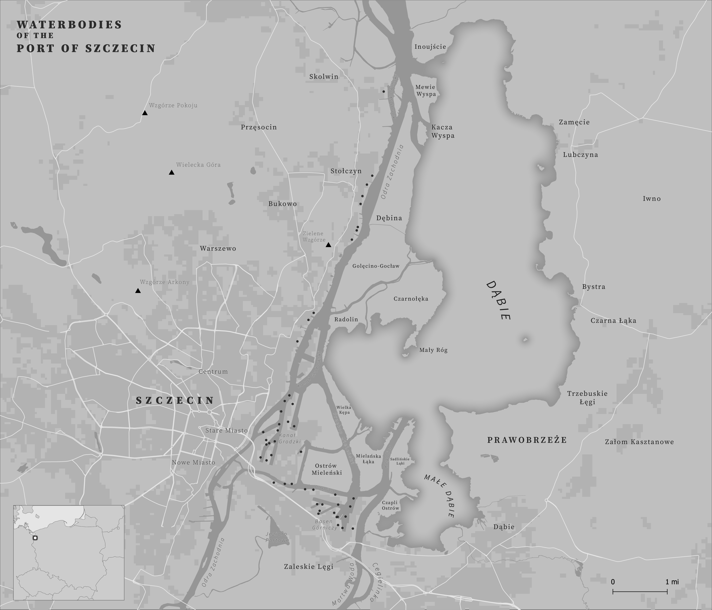
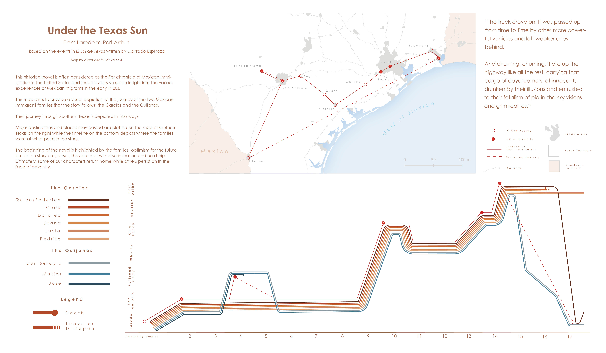
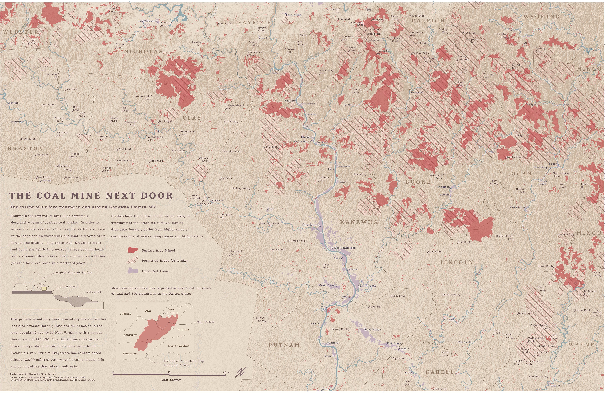

# Intro to Cartography

## Monochrome Map

  <a href="/assets/img/introcart/Szczecin.png"
     class="wide"
     data-pswp-width="2576"
     data-pswp-height="1503"
     target="_blank">
    
    
      <strong>Under the Texas Sun</strong> 
      Your caption text here: what the map shows, data sources, tools used.
    
  </a>

## Narrative Map

  <a href="/assets/img/introcart/shaded_relief.jpg"
     data-pswp-width="2576"
     data-pswp-height="1503"
     target="_blank">
    
    
      <strong>Under the Texas Sun</strong> 
      Your caption text here: what the map shows, data sources, tools used.
    
  </a>

## Terrain Study 

  <a href="/assets/img/introcart/UndertheTexasSun.jpg"
     class="wide"
     data-pswp-width="2576"
     data-pswp-height="1503"
     target="_blank">
    
    
      <strong>Under the Texas Sun</strong> 
      Your caption text here: what the map shows, data sources, tools used.
    
  </a>

# Cartographic Design Seminar

  <a href="/assets/img/introcart/cmnd_medium.png"
     class= "wide"
     data-pswp-width="5000"
     data-pswp-height="3256"
     target="_blank">
    
    
      <strong>The Coal Mine Next Door</strong> 
      Your caption text here: what the map shows, data sources, tools used.
    
  </a>

