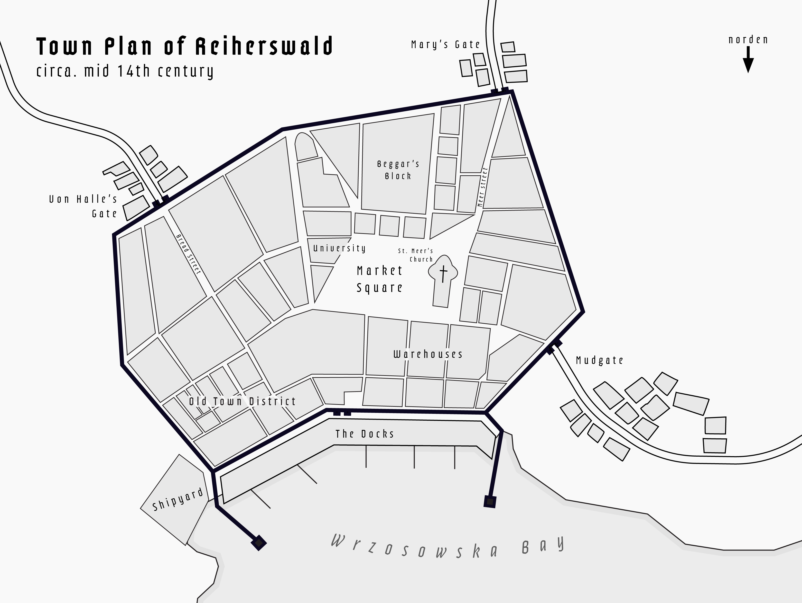

<link rel="stylesheet" href="https://unpkg.com/photoswipe@5/dist/photoswipe.css">
<link rel="stylesheet" href="https://unpkg.com/photoswipe-dynamic-caption-plugin/photoswipe-dynamic-caption-plugin.css">

“Making Our City: Reiherswald” is a collaborative project from a medieval cities course (HIST 0238, 2023) that I took in 2024. For our final project, we were grouped into “tithings” and asked to imagine a fictional medieval city: how it came to be, how it functioned and struggled to survive. What came out of it was Reiherswald, a Hanseatic port city on the Pomeranian coast of the Baltic. 
 
The other members of my tithing traced the cultural history of the city as well as it's its trade economy, shipbuilding prowess, institutions, and government. My contribution was to write the chapters on Reiherswald's urban development and existing infrastructure.  

Based on what I learned in the course and from extensive research of Hanseatic medieval cities, I imagined/argued the following in my chapters: 

* Reiherswald begins as a marshy Slavic-Germanic settlement on a lagoon inlet, a spot that was defensible and offered access to both the open sea and an upriver escape route. 
* German planners built over the earlier Slavic settlement, leaving only pottery fragments as evidence of their existence. These planners impose a regular, rectangular street grid radiating from a central market square, as was typical of eastern German colonial towns. These towns would be later filled with migrants from the West. 
* The cathedral, university, administrative buildings, and wealthy homes clustered around the main market square. Merchants typically lived near the center in order to have easy access to both the docks and places of commerce. The poor were pushed to the margins away from main roads and in closer proximity to the city gates. Businesses would line the three main roads leading to the gates, where there would be the most foot traffic. Warehouses sat by the docks in order to be proximal to the ships that would take/bring goods into the city. 
* As infrastructure grew with trade, the harbour expanded from a sandy beach into a sophisticated system of quays and ramparts. I learned that very little went to waste in the medieval era, and that salvaged shipwrecks were often used to patch docks when local timber ran low. Therefore, I also made that a commonplace occurence at Reiherswald!
* With the expansion of the harbour came a need for labor. I put the densest blocks in the northeast, where workers and commonfolk would live, away from the most desirable places but in a relatively better location than beggar’s block. 
* I spent much time contemplating the importance of the walls since the city walls and their gates were a critical element of every medieval city. In our city, the original wooden palisade was replaced by a brick wall beginning  in 1055, which took about ten years to build. The construction of the walls hemmed the city in, in turn creating “satellite” farming communities outside the walls. These communities were most at risk to raids and armed conflicts. 
* Water was a necessary element to consinder. In our case our proximity to water did us a service since Reiherswald’s citizens were able to get their water from wells and the channel. Pollution from a growing population and limited waste regulation would become a risk. At some point, a bridge-mounted water wheel was built that would be in turn copied and used by the brewer’s guild to increase production of beer/ale.
* Houses were typically constructed from wood during the earlier part of Reiherswald’s history when timber was abundant. As the nearby woods were cleared and lumber became more expensive, brick became the more popular building material. Brick was made in Reiherswald in town-controlled brickyards.

Along with the written portion of this project, I also contributed a map of what Reiherswald’s town plan would have looked like at its peak.

  

