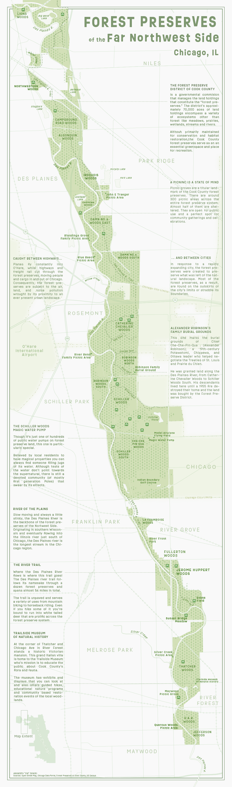
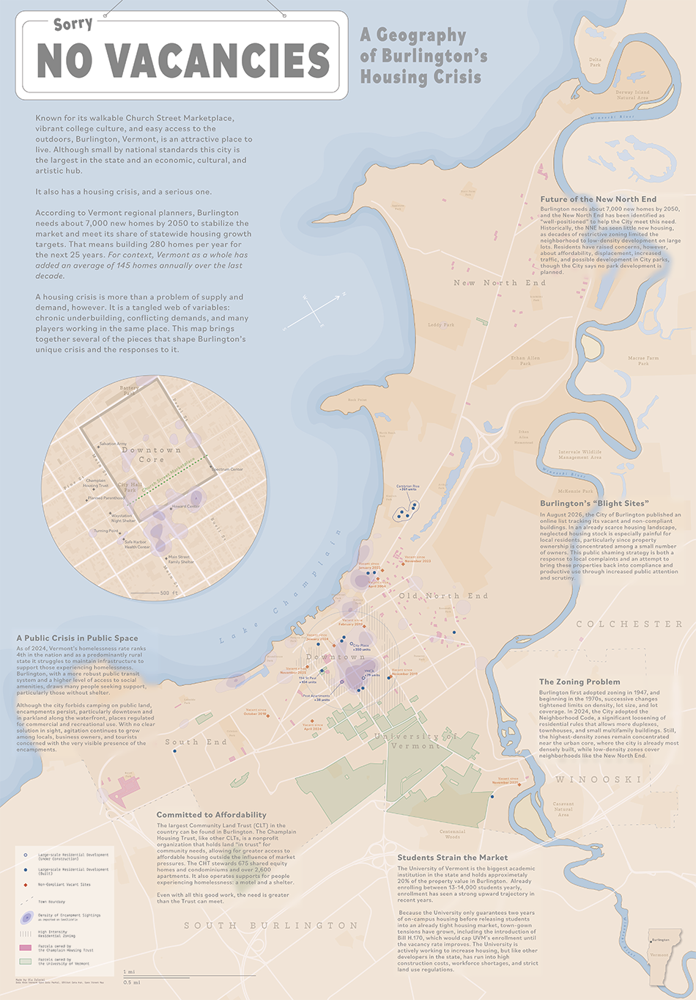
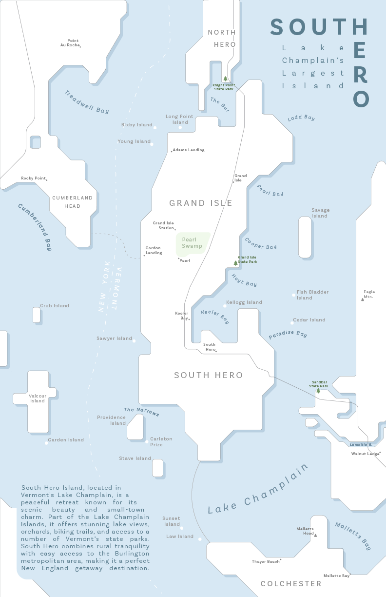
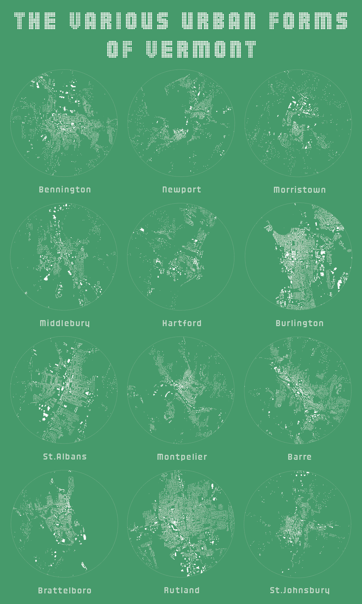
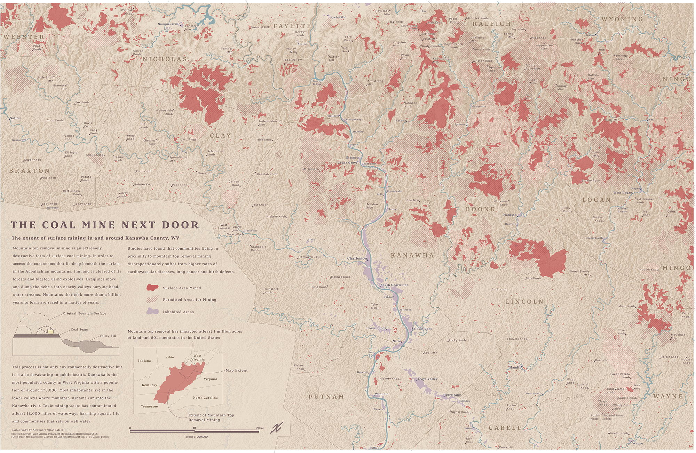
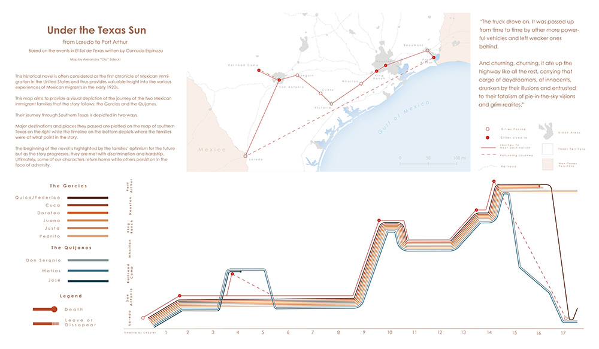

<link rel="stylesheet" href="https://unpkg.com/photoswipe@5/dist/photoswipe.css">
<link rel="stylesheet" href="https://unpkg.com/photoswipe-dynamic-caption-plugin/photoswipe-dynamic-caption-plugin.css">

  <a href="/assets/img/forestpreserves/ForestPreservesoftheFarNorthwestSide_medium.png"
     data-pswp-width="1950"
     data-pswp-height="6600"
     target="_blank">
    
    
      <strong>Forest Preserves of the Far Northwest Side</strong> 
      Your caption text here: what the map shows, data sources, tools used.
    
  </a>

  <a href="/assets/img/burlington/Burlington_medium.png"
     data-pswp-width="2900"
     data-pswp-height="4161"
     target="_blank">
    
    
      <strong>Sorry, No Vacancies: A Geography of Burlington's Housing Crisis</strong> 
      Your caption text here: what the map shows, data sources, tools used.
    
  </a>

  <a href="/assets/img/southhero/southhero_medium.png"
     data-pswp-width="1650"
     data-pswp-height="2550"
     target="_blank">
    
    
      <strong>Map of South Hero Island, Vermont</strong> 
      Your caption text here: what the map shows, data sources, tools used.
    
  </a>

  <a href="/assets/img/vtform/ruralforms_medium.png"
     data-pswp-width="2700"
     data-pswp-height="4500"
     target="_blank">
    
    
      <strong>Map Vermont Town Figure Grounds</strong> 
      Your caption text here: what the map shows, data sources, tools used.
    
  </a>

  <a href="/assets/img/cmnd/cmnd_medium.png"
     data-pswp-width="5000"
     data-pswp-height="3256"
     target="_blank">
    
    
      <strong>The Coal Mine Next Door</strong> 
      Your caption text here: what the map shows, data sources, tools used.
    
  </a>

  <a href="/assets/img/texassun/UndertheTexasSun.jpg"
     data-pswp-width="2576"
     data-pswp-height="1503"
     target="_blank">
    
    
      <strong>Under the Texas Sun</strong> 
      Your caption text here: what the map shows, data sources, tools used.
    
  </a>

