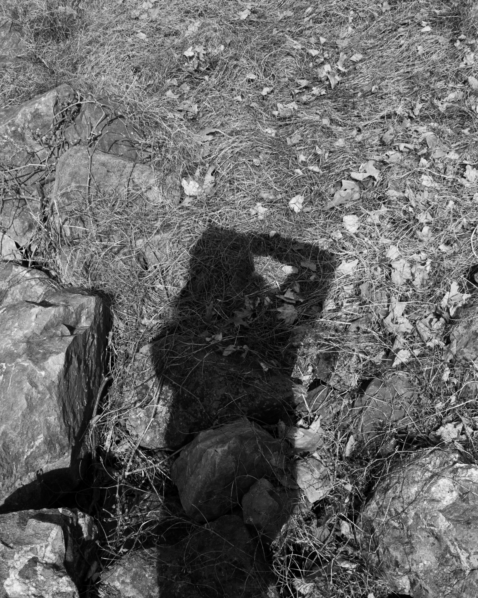
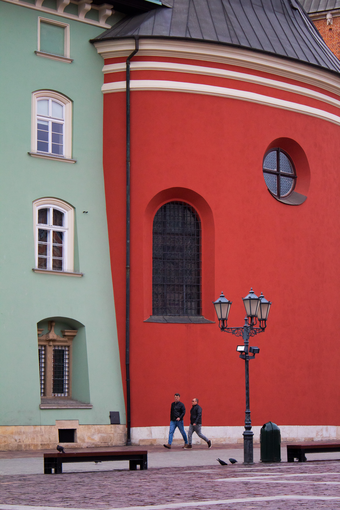
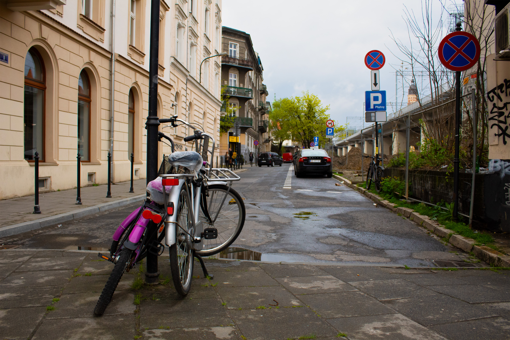
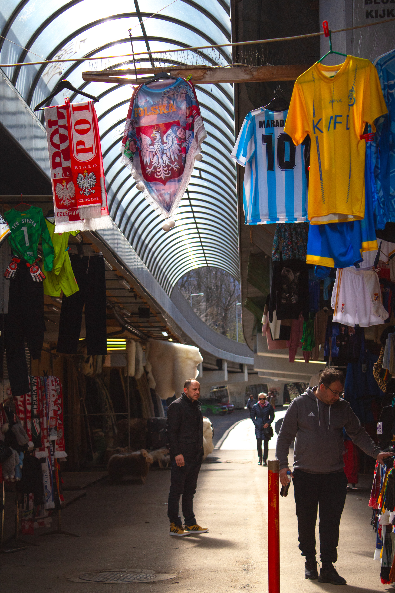
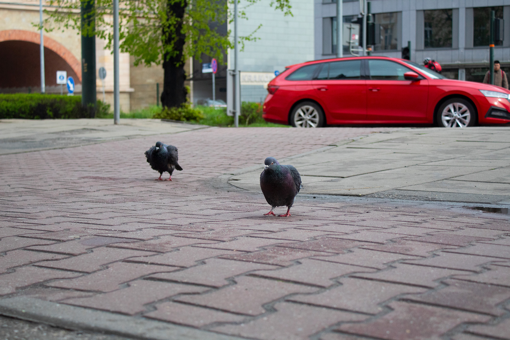
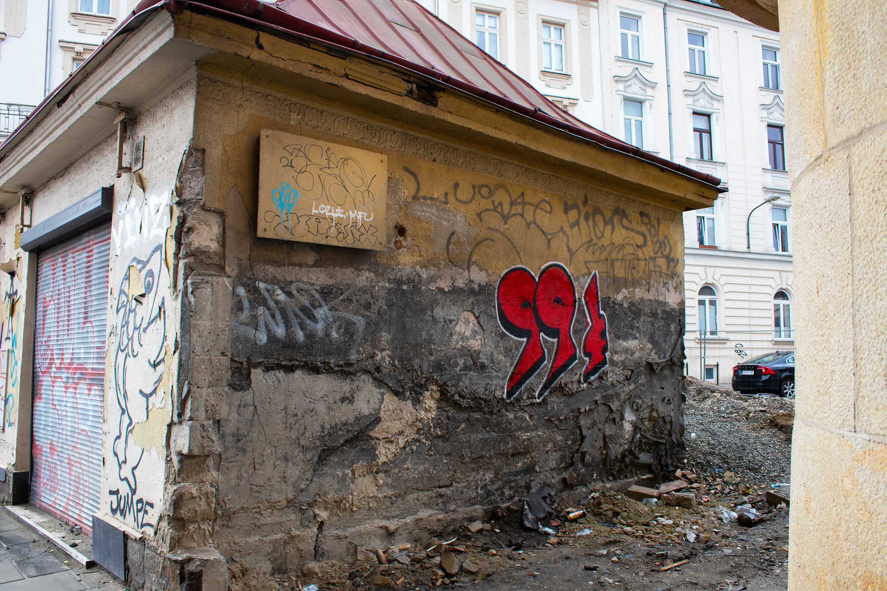
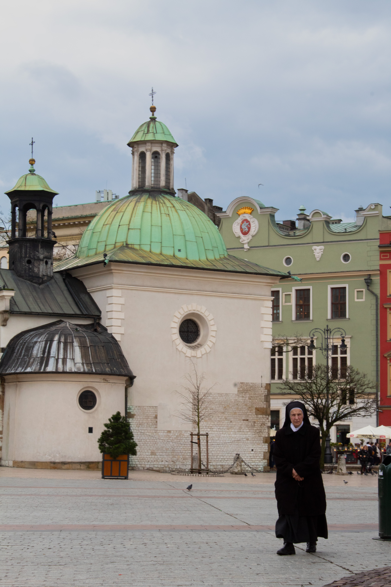
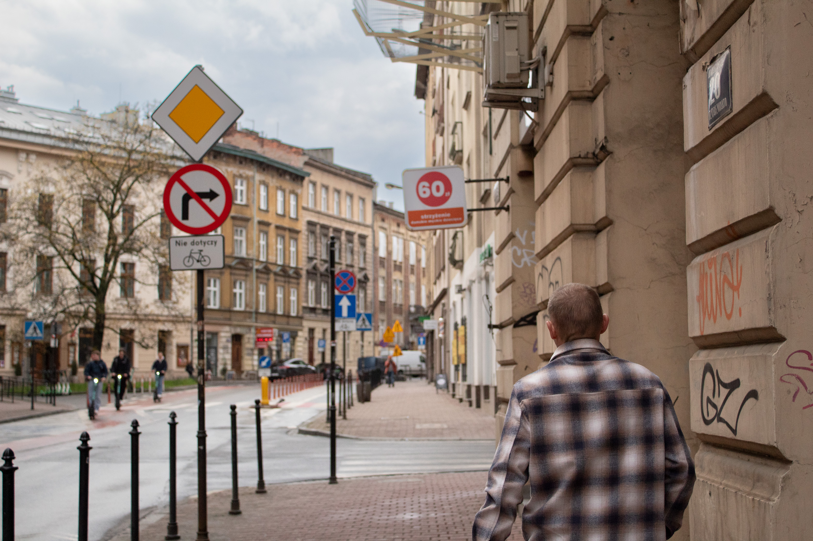

<link rel="stylesheet" href="https://unpkg.com/photoswipe@5/dist/photoswipe.css"> <link rel="stylesheet" href="https://unpkg.com/photoswipe-dynamic-caption-plugin/photoswipe-dynamic-caption-plugin.css"> 

## Studio Portrait and Still Life Diptych

<a href="/assets/img/photography/portrait.jpg" 
data-pswp-width="1763" 
data-pswp-height="2576" 
target="_blank"> 
  
  <strong>Image 4 title</strong> Caption text here. 
 
</a>

<a href="/assets/img/photography/stilllife.jpg" 
data-pswp-width="1763" 
data-pswp-height="2576" 
target="_blank"> 
  
<strong>Image 4 title</strong> Caption text here. 
 
</a>

## In the Style of
Create a photo series In the Style of a Photographer. Replicate one image by that photographer and then create 1 more image inspired by that photographer’s style.

In addition to the series, prepare a one minute presentation on the photographer, introducing their work, biographical information, and identifying major aspects of their technique and style. You will present this material before your critique.

<a href="/assets/img/photography/inthestyle1.jpg" 
data-pswp-width="3509" 
data-pswp-height="2576" 
target="_blank"> 
  
<strong>Image 1 title</strong> Caption text here. 
 
</a>

<a href="/assets/img/photography/inthestyle2.jpg" 
data-pswp-width="2060" 
data-pswp-height="2576" 
target="_blank"> 
  
<strong>Image 2 title</strong> Caption text here. 
 
</a>

## Final Projects

<a href="/assets/img/photography/pairwalking.jpg" 
data-pswp-width="3300" 
data-pswp-height="4950" 
target="_blank"> 
  <strong>Image 1 title</strong> Caption text here.  </a>

<a href="/assets/img/photography/bikes.jpg" 
data-pswp-width="2048" 
data-pswp-height="1365" 
target="_blank"> 
  <strong>Image 2 title</strong> Caption text here.  </a>

<a href="/assets/img/photography/jerseys.jpg" 
data-pswp-width="1365" 
data-pswp-height="2048" 
target="_blank"> 
  <strong>Image 3 title</strong> Caption text here.  </a>

<a href="/assets/img/photography/birds.jpg" 
data-pswp-width="2048" 
data-pswp-height="1365" 
target="_blank"> 
  <strong>Image 4 title</strong> Caption text here.  </a>

<a href="/assets/img/photography/ninetyninecents.jpg" 
data-pswp-width="2400" 
data-pswp-height="1600" 
target="_blank"> 
  <strong>Image 5 title</strong> Caption text here.  </a>

<a href="/assets/img/photography/nun.jpg" 
data-pswp-width="3456" 
data-pswp-height="5184" 
target="_blank"> 
  <strong>Image 6 title</strong> Caption text here.  </a>

<a href="/assets/img/photography/singlemanwalking.jpg" 
data-pswp-width="3150" 
data-pswp-height="2100" 
target="_blank"> 
  <strong>Image 7 title</strong> Caption text here.  </a>

