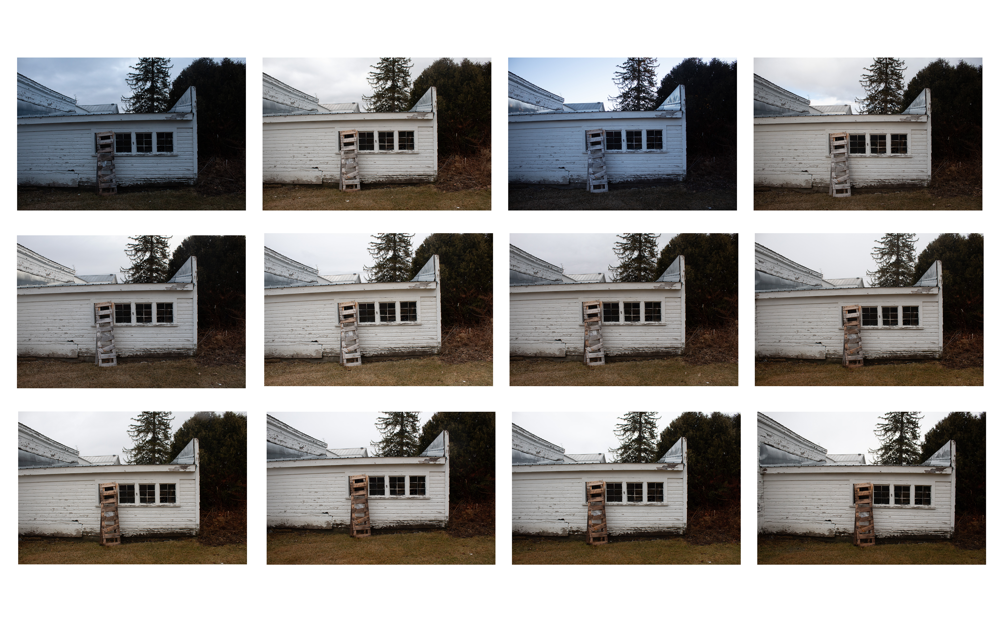
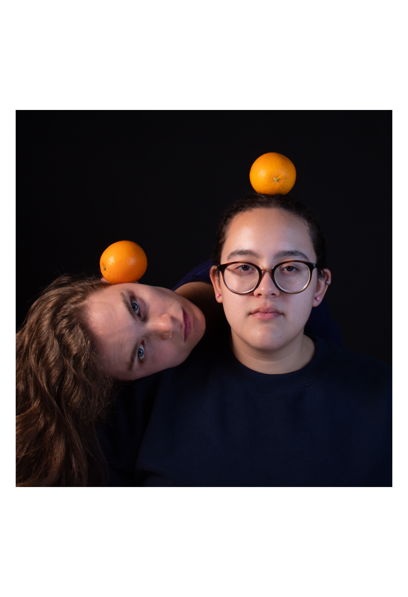
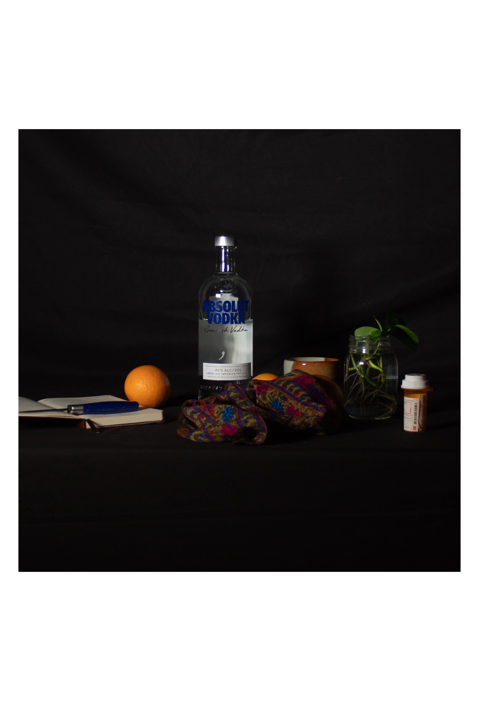
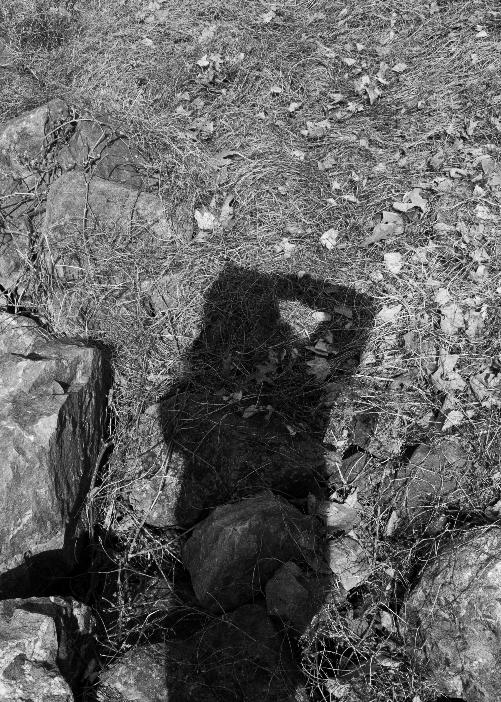
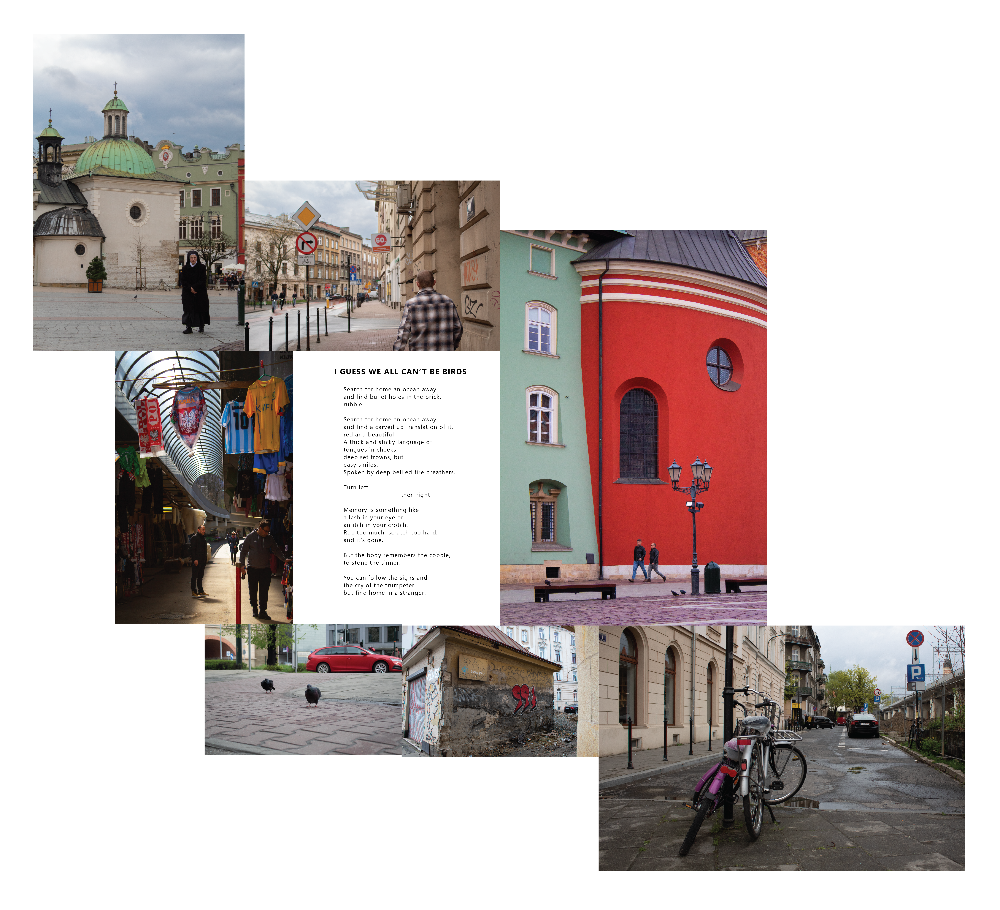
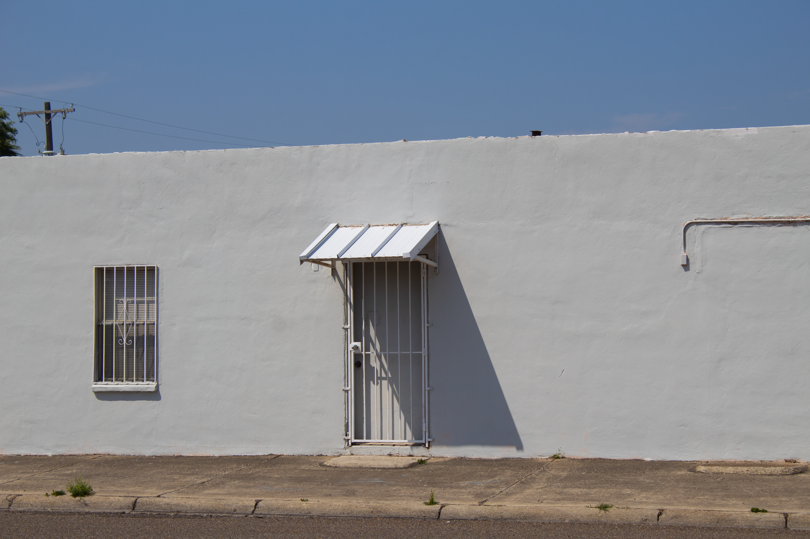
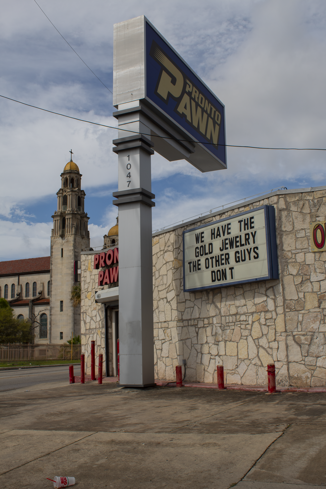
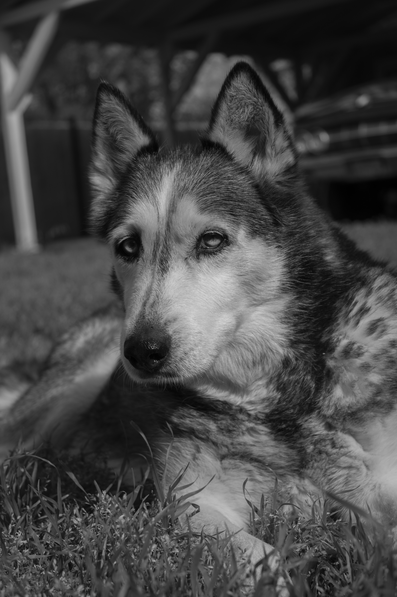
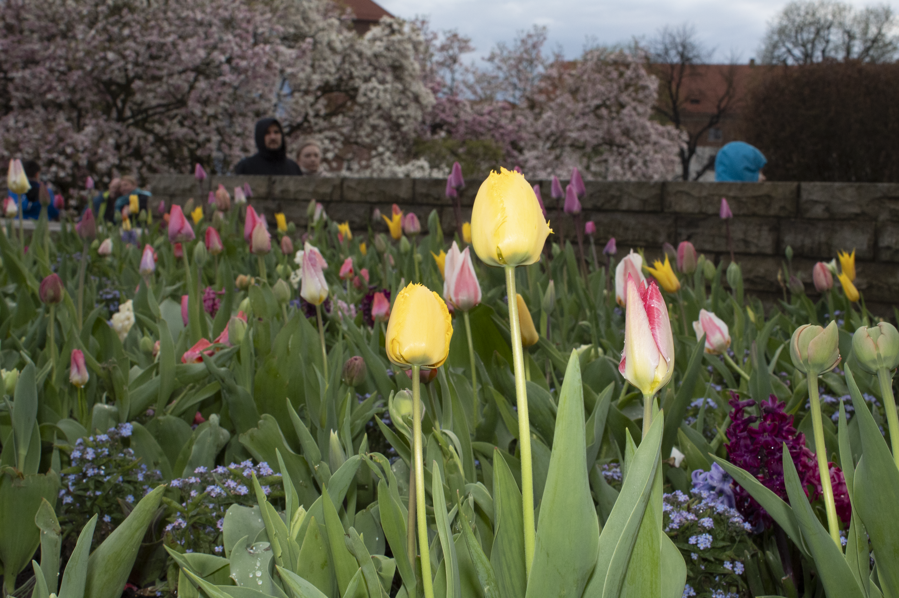
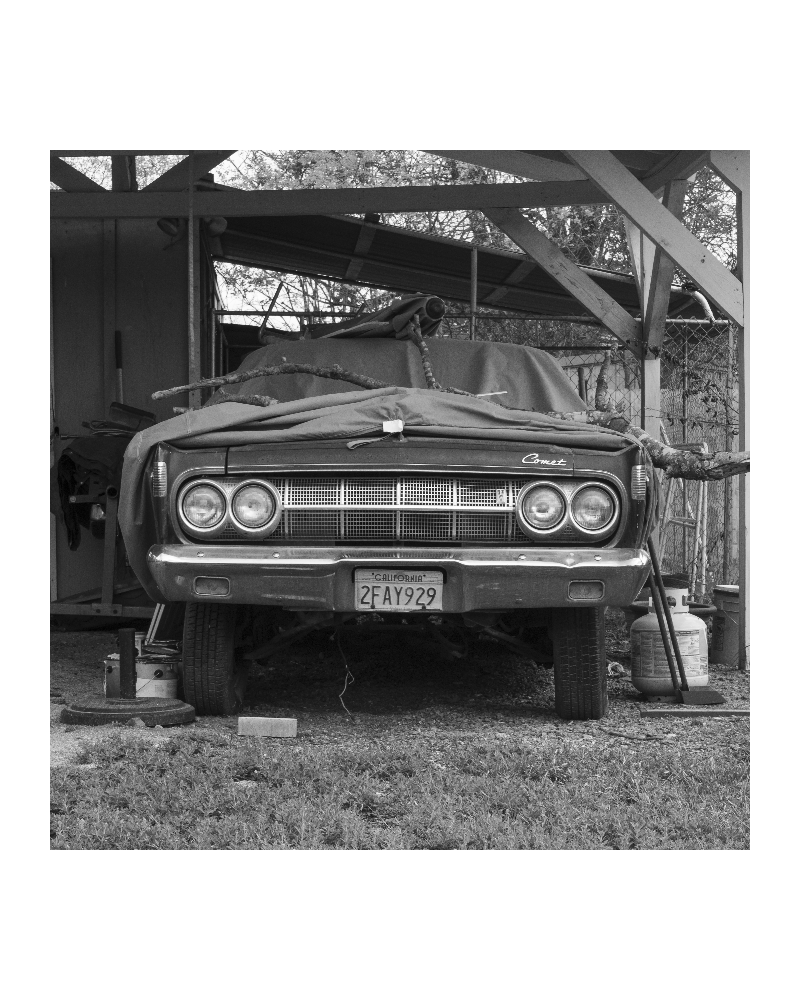

<link rel="stylesheet" href="https://unpkg.com/photoswipe@5/dist/photoswipe.css">
<link rel="stylesheet" href="https://unpkg.com/photoswipe-dynamic-caption-plugin/photoswipe-dynamic-caption-plugin.css">

## Long Form Study: Light and Time
Perform a long-form study by photographing the same scene at least 2 different times of day for 6 days. The result will be a series of 12 photographs (you may choose to show more if you wish) depicting the way light defines and informs that scene.

  <a href="/assets/img/photography/LongformLayout.png"
     class="wide"
     data-pswp-width="4000" data-pswp-height="2546" data-cropped="true"
     target="_blank">
    
    
      <strong>Image 4 title</strong> Caption text here.
    
  </a>

## Studio Portrait and Still Life Diptych

  <a href="/assets/img/photography/portrait.jpg"
     data-pswp-width="2550" data-pswp-height="3300" data-cropped="true"
     target="_blank">
    
    
      <strong>Image 4 title</strong> Caption text here.
    
  </a>

  <a href="/assets/img/photography/stilllife.jpg"
     data-pswp-width="1763" data-pswp-height="2576" data-cropped="true"
     target="_blank">
    
    
      <strong>Image 4 title</strong> Caption text here.
    
  </a>

## In the Style of
Create a photo series In the Style of a Photographer. Replicate one image by that photographer and then create 1 more image inspired by that photographer’s style.

In addition to the series, prepare a one minute presentation on the photographer, introducing their work, biographical information, and identifying major aspects of their technique and style. You will present this material before your critique.

  <a href="/assets/img/photography/inthestyle1_57.jpg"
     data-pswp-width="2601" data-pswp-height="3642" data-cropped="true"
     target="_blank">
    
    
      <strong>Image 4 title</strong> Caption text here.
    
  </a>

  <a href="/assets/img/photography/inthestyle2_57.jpg"
     data-pswp-width="2601" data-pswp-height="3642" data-cropped="true"
     target="_blank">
    
    
      <strong>Image 4 title</strong> Caption text here.
    
  </a>

## Final Project

  <a href="/assets/img/photography/final_layout_medium.png"
     class="wide" 
     data-pswp-width="6630" data-pswp-height="6036" data-cropped="true"
     target="_blank">
    
    
      <strong>Image 4 title</strong> Caption text here.
    
  </a>

## Honorable Mentions

One of the underlying "assignments" for the duration of the class was to take as many photos as possible. For that semester, the DSLR that I loaned from the studio went with me everywhere. Here is a selection of photos that do not belong to a particular body of work, but that I wanted to share, nonetheless!

  

  

  

  

  

