<link rel="stylesheet" href="https://unpkg.com/photoswipe@5/dist/photoswipe.css">
<link rel="stylesheet" href="https://unpkg.com/photoswipe-dynamic-caption-plugin/photoswipe-dynamic-caption-plugin.css">

## Intro to the Project
Winter term course
to this day regret not taking a formal architecture class in college 

fast paced introduction to elements from both architecture and urban theory

### Why the Wells-Richardson Building 
 - heritage site, old, centrally located 
 - industrial building 
 - part of a greater complex
 - attracted to it's aesthetic, red brick, tall, 

## History
introduce your building and its function(s), explain its relationship to the city of Burlington, and elaborate on the changes it has undergone.

## Site Visit

### Structure

  <a href="/assets/img/buildings/front_street_view.jpg"
     data-pswp-width="960" data-pswp-height="720" data-cropped="true"
     target="_blank">
    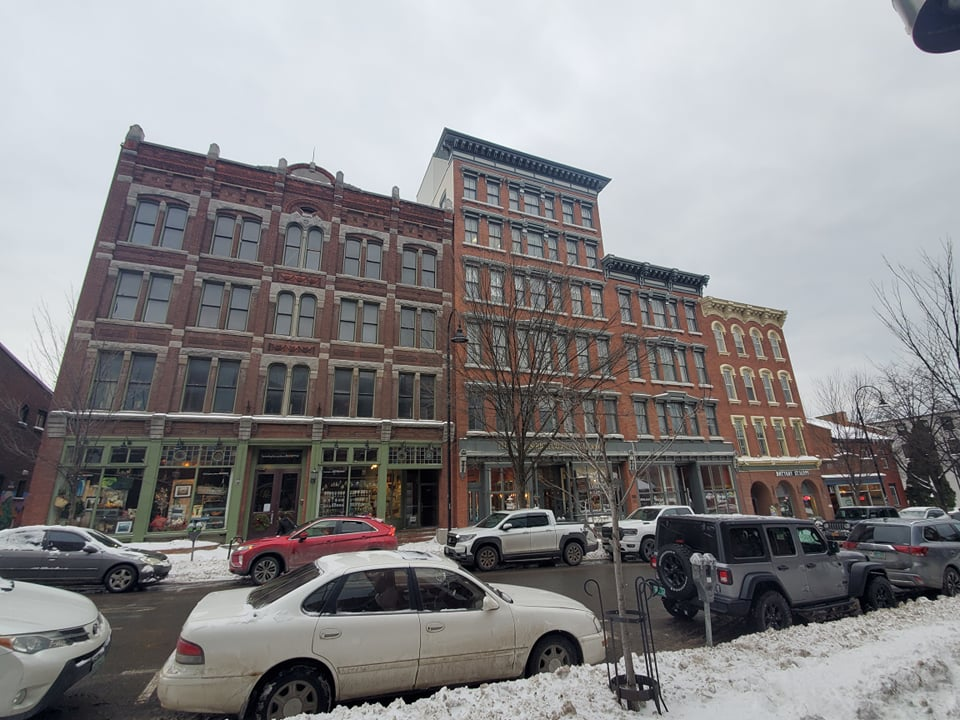
    
      <strong>View from across the street with other building faces visible</strong>
    
  </a>

  <a href="/assets/img/buildings/side_street_view.jpg"
     data-pswp-width="960" data-pswp-height="720" data-cropped="true"
     target="_blank">
    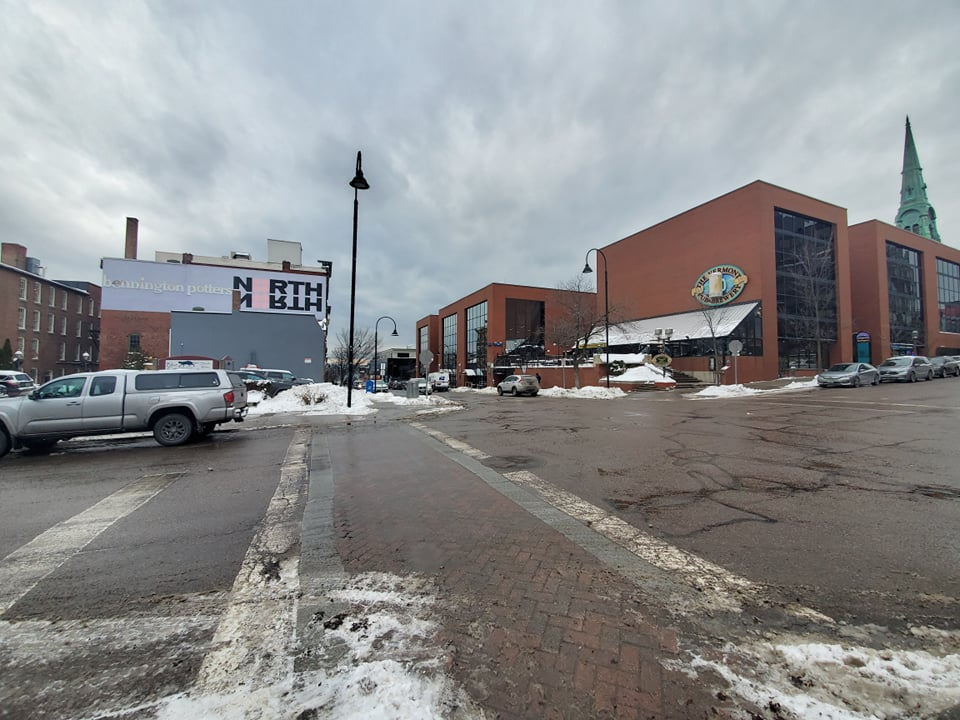
    
      <strong>View from the St.Paul St and College St. Intersection</strong>  Pottery advert is mainly in view
    
   </a>
  <a href="/assets/img/buildings/front_facade.jpg"
     data-pswp-width="720" data-pswp-height="873" data-cropped="true"
     target="_blank">
    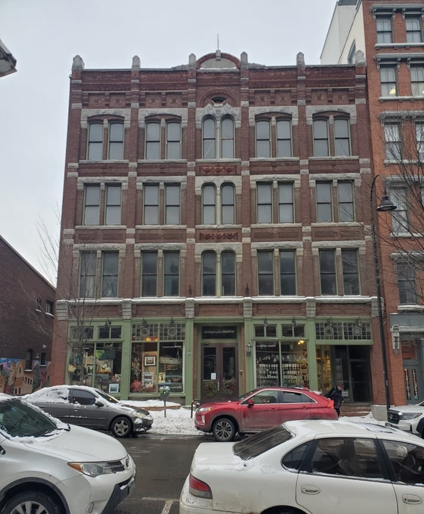
    
      <strong>Front Facade of the Wells-Richardson Building</strong>
    
    </a>
  <a href="/assets/img/buildings/viewshed.jpg"
     data-pswp-width="960" data-pswp-height="720" data-cropped="true"
     target="_blank">
    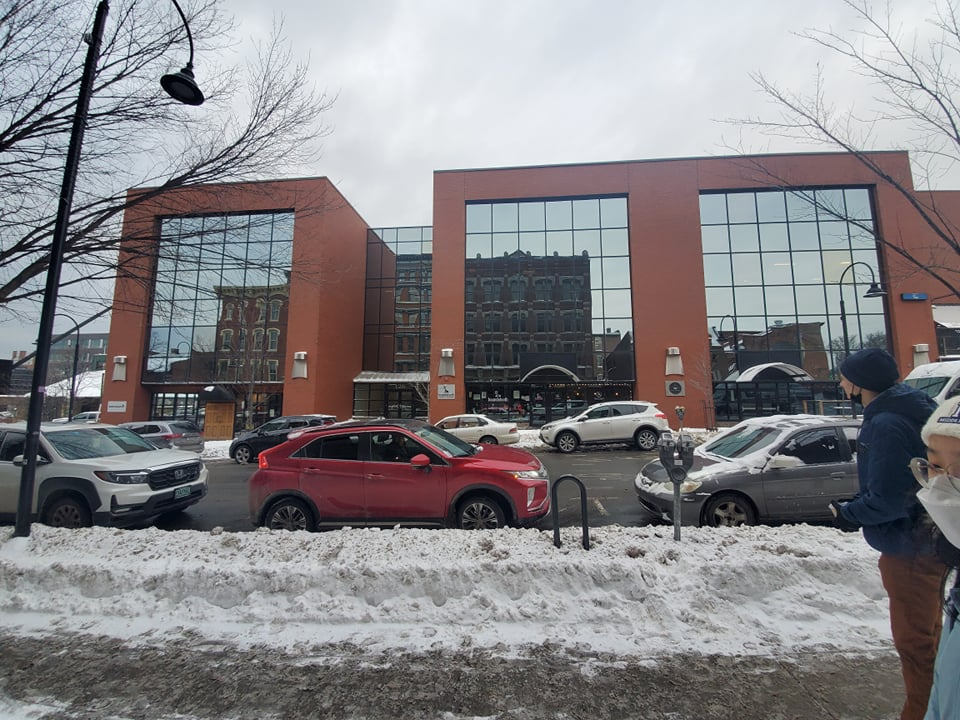
    
      <strong>View from entrance</strong>
    
  </a>

  <a href="/assets/img/buildings/side_back_view.jpg"
     data-pswp-width="960" data-pswp-height="720" data-cropped="true"
     target="_blank">
    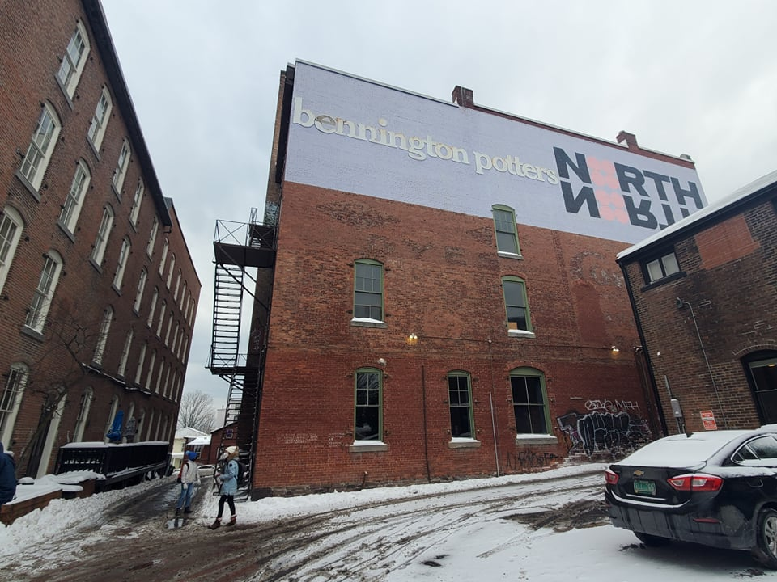
    
      <strong>Eastern side of the building with advert in closer view</strong>
    
  </a>

  <a href="/assets/img/buildings/side_back_view.jpg"
     data-pswp-width="960" data-pswp-height="720" data-cropped="true"
     target="_blank">
    
    
      <strong>Eastern side of the building with advert in closer view</strong>
    
  </a>

  <a href="/assets/img/buildings/back_from_corner.jpg"
     data-pswp-width="960" data-pswp-height="720" data-cropped="true"
     target="_blank">
    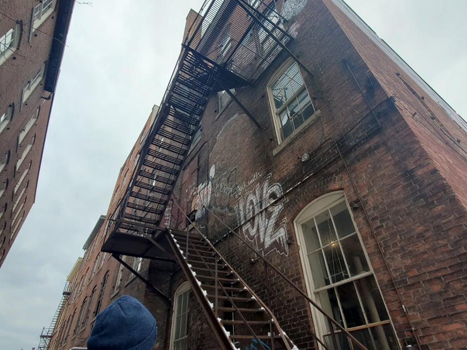
    
      <strong>Eastern side of the building with advert in closer view</strong>
    
  </a>

  <a href="/assets/img/buildings/below_back_view.jpg"
     data-pswp-width="960" data-pswp-height="720" data-cropped="true"
     target="_blank">
    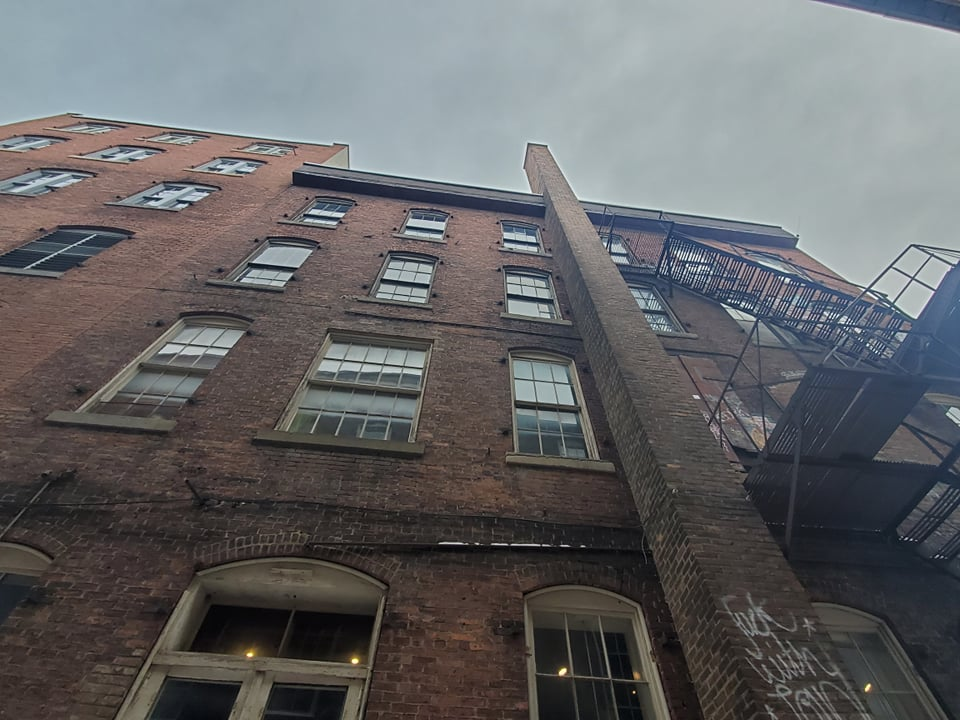
    
      <strong>Eastern side of the building with advert in closer view</strong>
    
  </a>

### Details
Lorem ipsum dolor sit amet, consectetur adipiscing elit. Ut vitae leo in velit posuere tristique. Vivamus vel imperdiet lectus, sit amet tincidunt neque. Mauris sodales augue odio, eu porta ipsum imperdiet a. Nulla euismod, leo quis cursus tempor, nulla tortor scelerisque leo, vitae vestibulum nunc velit vitae odio. Proin ac nibh tempor leo molestie pharetra. Vestibulum nisl dui, lobortis posuere purus quis, maximus euismod justo. Fusce id cursus sem, quis rutrum sem. Etiam eget dui vel dolor sagittis tempor a non ex. Nulla mauris justo, euismod id suscipit vel, porta et magna. Cras ac massa eu sem blandit ullamcorper. Quisque quis scelerisque dolor, vel porta erat. Integer vel massa a ipsum iaculis imperdiet non non est.

  <a href="/assets/img/buildings/sill_closeup.jpg"
     data-pswp-width="960" data-pswp-height="720" data-cropped="true"
     target="_blank">
    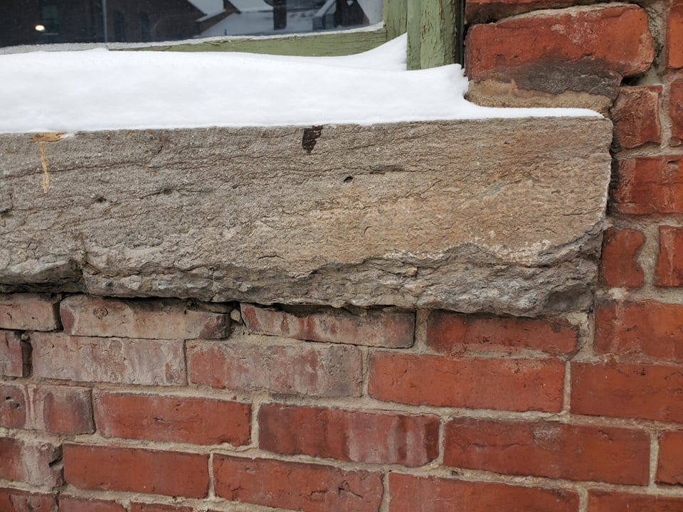
    
      <strong>Sill (granite) with chipped off sides</strong>
    
  </a>

  <a href="/assets/img/buildings/graffitti.jpg"
     data-pswp-width="960" data-pswp-height="720" data-cropped="true"
     target="_blank">
    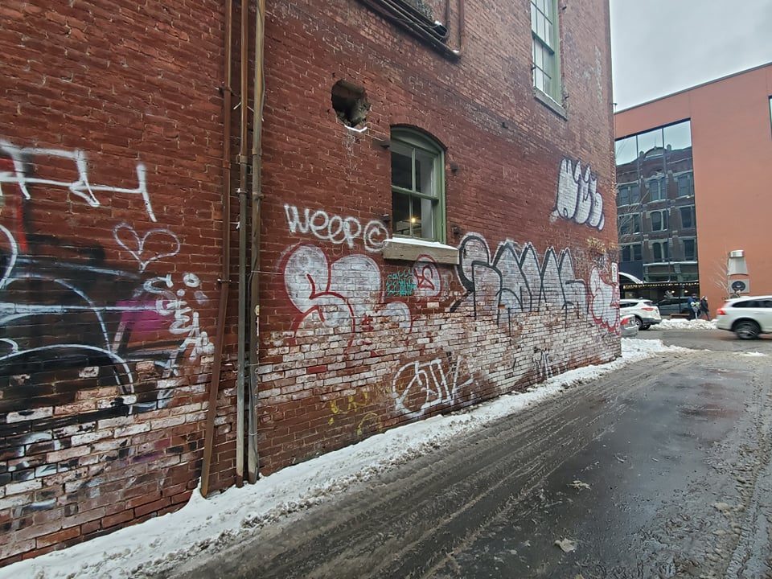
    
      <strong>Graffitti on exposed side of building (east)</strong>
    
    </a>

  <a href="/assets/img/buildings/disjoint_brick.jpg"
     data-pswp-width="720" data-pswp-height="873" data-cropped="true"
     target="_blank">
    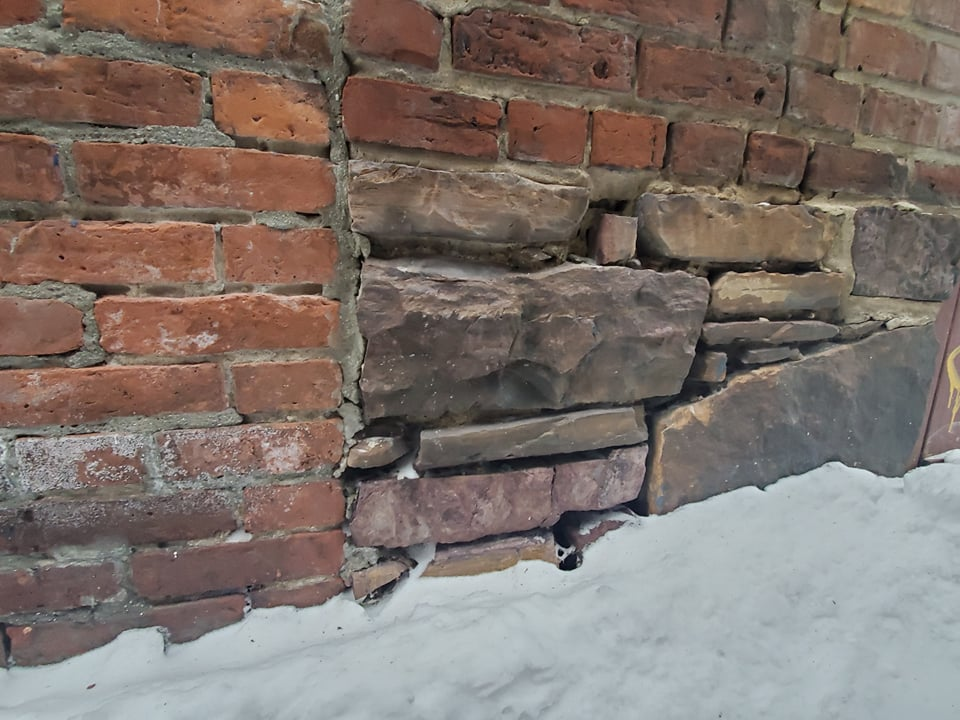
    
      <strong>Disjoint materials for foundation</strong>
    
    </a>

  <a href="/assets/img/buildings/chipping_brick.jpg"
     data-pswp-width="960" data-pswp-height="720" data-cropped="true"
     target="_blank">
    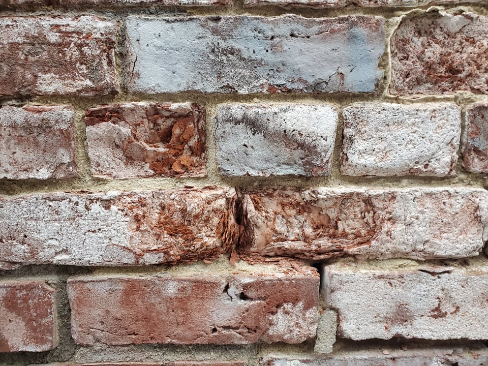
    
      <strong>Spalling</strong>  In certain parts of the eastern wall, brick was chipping. Most likely due to moisture saturating the brick.
    
  </a>

  <a href="/assets/img/buildings/brick_wood_close.jpg"
     data-pswp-width="960" data-pswp-height="720" data-cropped="true"
     target="_blank">
    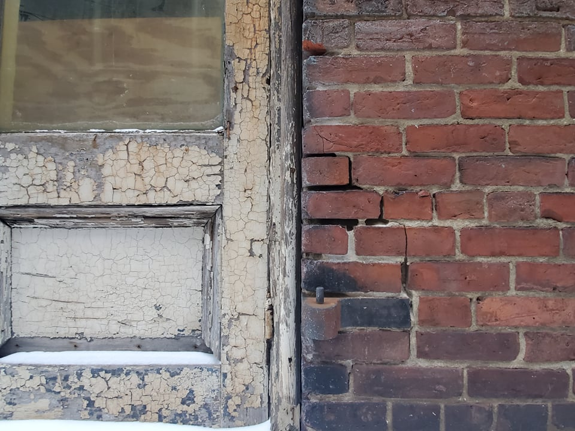
    
      <strong>Eastern side of the building with advert in closer view</strong>
    
  </a>

  <a href="/assets/img/buildings/side_back_view.jpg"
     data-pswp-width="960" data-pswp-height="720" data-cropped="true"
     target="_blank">
    
    
      <strong>Eastern side of the building with advert in closer view</strong>
    
  </a>

  <a href="/assets/img/buildings/birds_nest.jpg"
     data-pswp-width="720" data-pswp-height="960" data-cropped="true"
     target="_blank">
    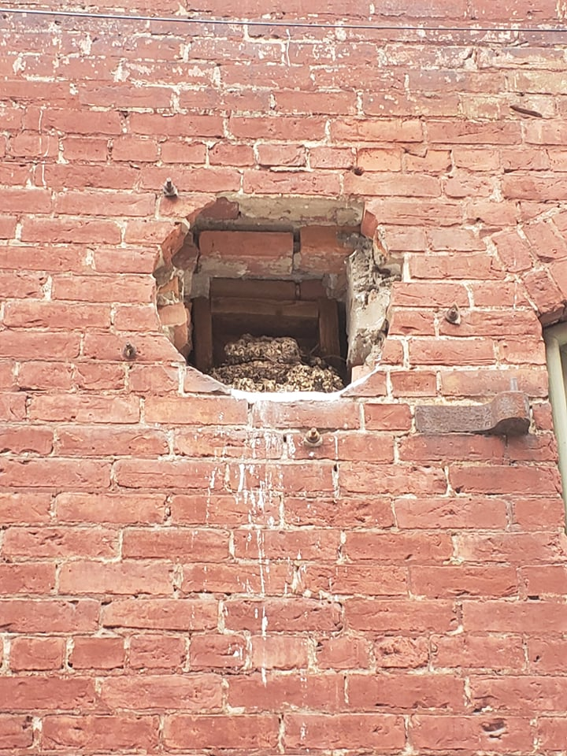
    
      <strong>A bird's home</strong>
    
  </a>

  <a href="/assets/img/buildings/closed_sign.jpg"
     data-pswp-width="720" data-pswp-height="960" data-cropped="true"
     target="_blank">
    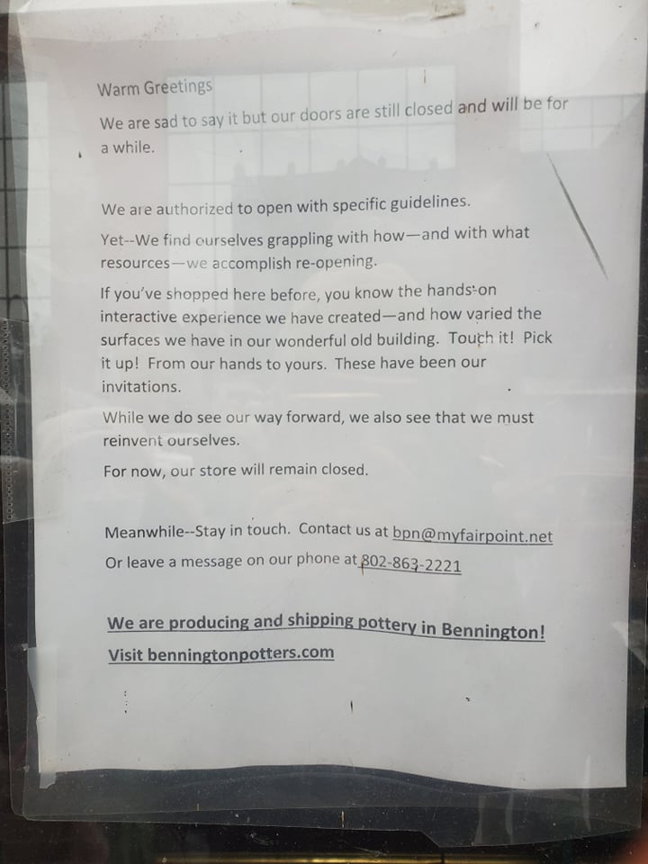
    
      <strong>A bird's home</strong>
    
  </a>

### Material Palette
Lorem ipsum dolor sit amet, consectetur adipiscing elit. Ut vitae leo in velit posuere tristique. Vivamus vel imperdiet lectus, sit amet tincidunt neque. Mauris sodales augue odio, eu porta ipsum imperdiet a. Nulla euismod, leo quis cursus tempor, nulla tortor scelerisque leo, vitae vestibulum nunc velit vitae odio. Proin ac nibh tempor leo molestie pharetra. Vestibulum nisl dui, lobortis posuere purus quis, maximus euismod justo. Fusce id cursus sem, quis rutrum sem. Etiam eget dui vel dolor sagittis tempor a non ex. Nulla mauris justo, euismod id suscipit vel, porta et magna. Cras ac massa eu sem blandit ullamcorper. Quisque quis scelerisque dolor, vel porta erat. Integer vel massa a ipsum iaculis imperdiet non non est.

### Sketches and Drawings

  <a href="/assets/img/buildings/stained_glass_sketch.jpeg"
     data-pswp-width="3103" data-pswp-height="1233" data-cropped="true"
     target="_blank">
    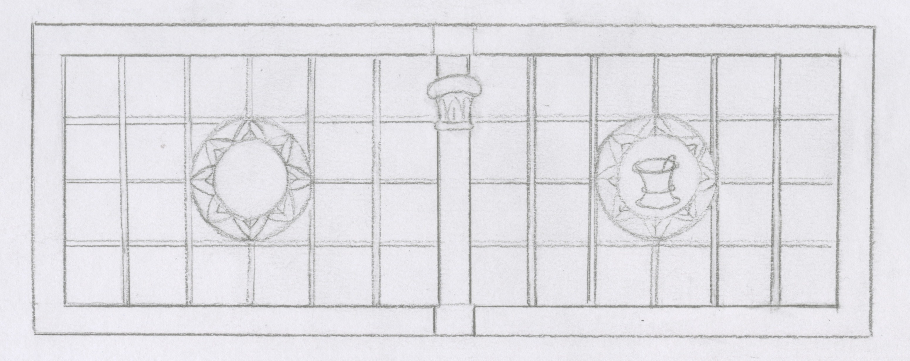
    
      <strong>Sketch of stained glass ornaments</strong>
    
    </a>

  <a href="/assets/img/buildings/facade_pencil.jpeg"
     data-pswp-width="960" data-pswp-height="720" data-cropped="true"
     target="_blank">
    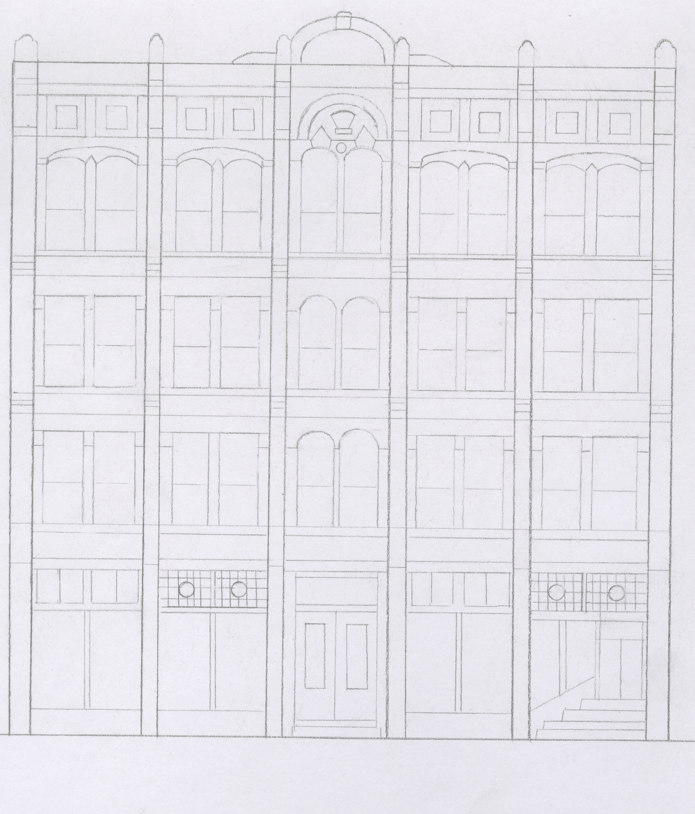
    
      <strong>Sill (granite) with chipped off sides</strong>
    
  </a>

  <a href="/assets/img/buildings/facade_watercolor.jpeg"
     data-pswp-width="814" data-pswp-height="956" data-cropped="true"
     target="_blank">
    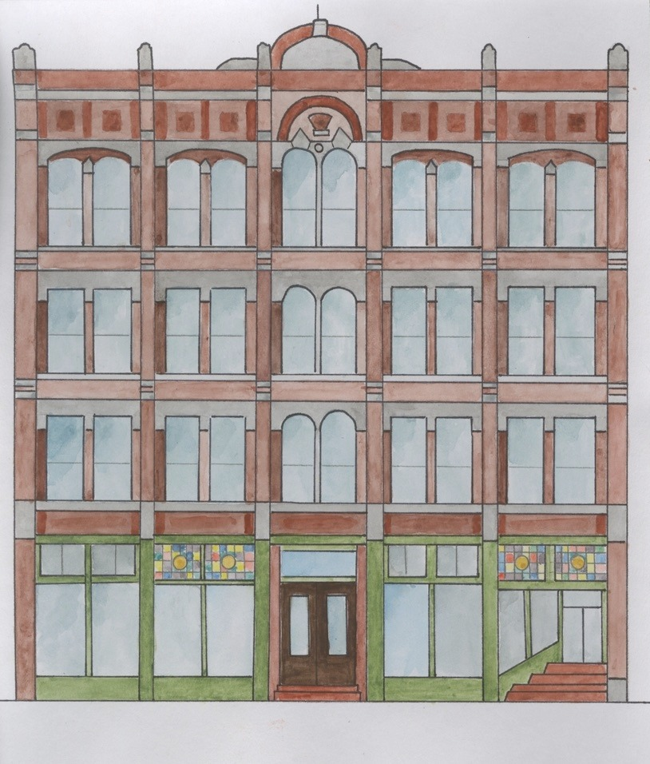
    
      <strong>Graffitti on exposed side of building (east)</strong>
    
    </a>

  <a href="/assets/img/buildings/mural_timeline.jpeg"
     data-pswp-width="1021" data-pswp-height="735" data-cropped="true"
     target="_blank">
    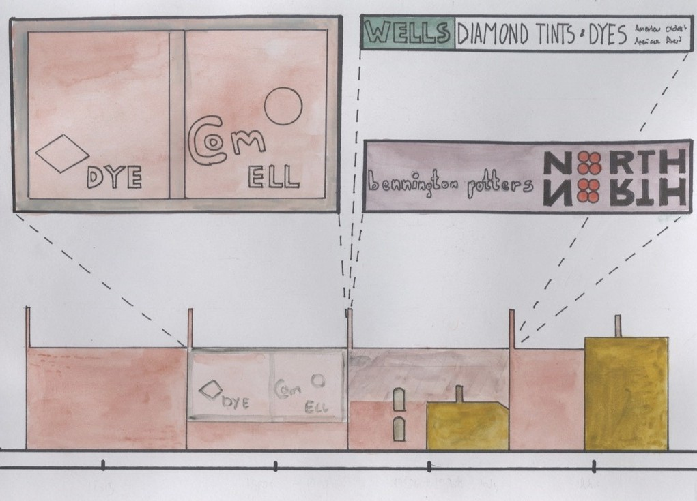
    
      <strong>Changes of the eastern wall over time</strong>
    
    </a>

## Present 
Cras mollis orci eu lacinia tempus. Phasellus gravida felis dignissim ultricies porta. Ut ut semper nibh. Nullam varius luctus tortor, id consequat dui pulvinar vel. Mauris auctor velit tortor, vitae blandit ante euismod quis. Cras feugiat molestie risus, eu efficitur nisi ultricies eget. Aliquam ut rhoncus nunc, quis fringilla justo. Vivamus sed arcu vestibulum, blandit ante et, tincidunt diam. Fusce ac tincidunt augue. Nullam at ligula ultricies, rhoncus urna sed, feugiat ipsum. Suspendisse vestibulum ultrices mauris vitae condimentum. Cras sit amet nulla varius, pulvinar quam ac, pretium mi.

### Relationships
Praesent aliquam id augue eu fringilla. Pellentesque enim felis, faucibus interdum dolor sed, tincidunt imperdiet lacus. Praesent at fringilla dolor, sit amet sollicitudin mi. Nulla in commodo purus. Aenean facilisis lacus vitae lacus viverra ullamcorper. Duis quis tempus est, ornare molestie lectus. Curabitur at aliquet erat. Morbi iaculis congue tortor, at hendrerit urna sagittis quis. Vestibulum malesuada risus ac magna tincidunt scelerisque. Nullam quis ante turpis. Donec convallis consectetur accumsan. Nulla venenatis ut dolor tempus condimentum. Suspendisse sodales aliquet massa, eu pharetra velit ullamcorper non. Vestibulum efficitur, risus eget imperdiet viverra, purus orci hendrerit ex, ut lobortis libero erat id ex. Donec non mattis mauris.

### Maps

  <a href="/assets/img/buildings/BurlingtonTransit_final.png"
     data-pswp-width="3507" data-pswp-height="2480" data-cropped="true"
     target="_blank">
    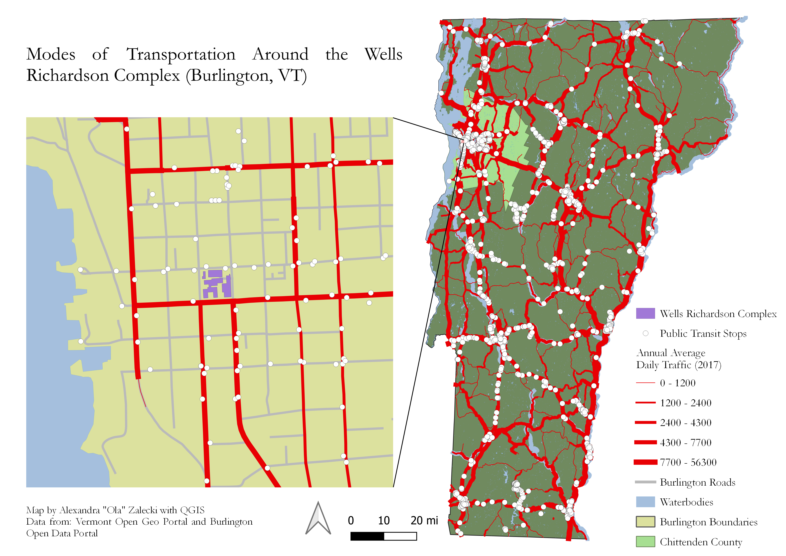
    
      <strong>How to get to the building</strong>
    
    </a>

  <a href="/assets/img/buildings/siteplan500updated.jpg"
     data-pswp-width="5500" data-pswp-height="4252" data-cropped="true"
     target="_blank">
    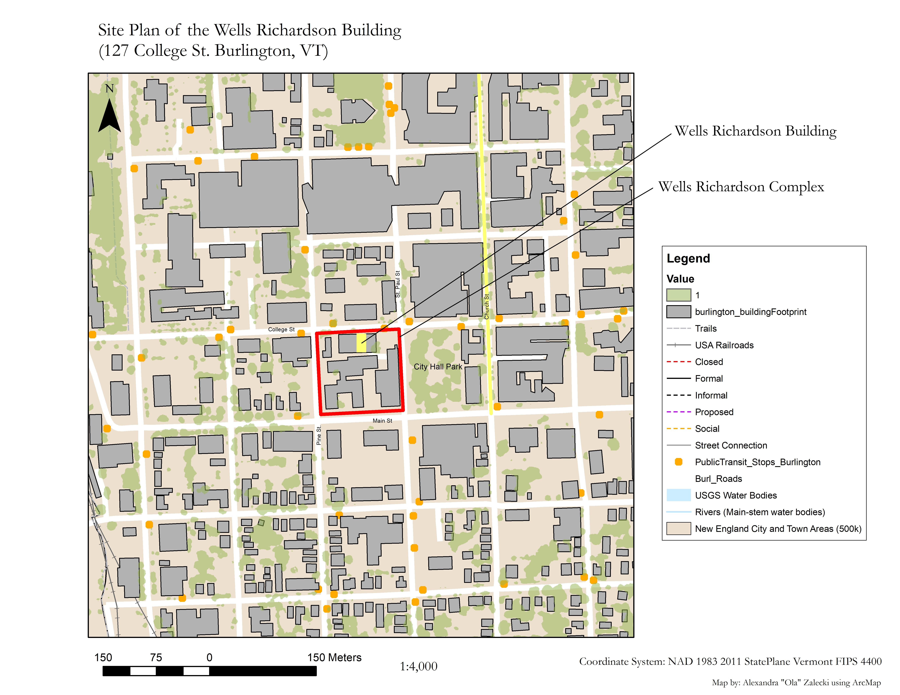
    
      <strong>Site plan</strong>
    
  </a>

### The Building Now
Curabitur nec nulla eget ipsum faucibus dignissim. Vestibulum vulputate lorem id imperdiet finibus. Ut in aliquet ipsum, sed suscipit nisi. Fusce at dictum quam, in pellentesque mauris. Vestibulum ornare ante mauris, et vulputate tortor posuere at. Etiam ultricies efficitur fermentum. Nunc elementum a odio non sagittis. Nunc imperdiet ac enim a dictum. Integer molestie volutpat erat quis posuere.

## Conclusion 
Vivamus sed dictum libero, nec congue ex. Nullam diam odio, eleifend quis tempus vel, sagittis interdum quam. Nulla facilisi. Nunc iaculis enim sit amet pretium ornare. Praesent dictum aliquet libero. Mauris aliquet, ex ut egestas finibus, ligula nunc feugiat turpis, nec tristique urna mauris et odio. Proin posuere ornare arcu, vitae finibus massa dapibus at. Nam maximus nunc ac massa consequat malesuada.

 