<link rel="stylesheet" href="https://unpkg.com/photoswipe@5/dist/photoswipe.css">
<link rel="stylesheet" href="https://unpkg.com/photoswipe-dynamic-caption-plugin/photoswipe-dynamic-caption-plugin.css">

## Intro to the Project
Winter term course in 2022 to this day regret not taking a formal architecture class in college 

fast paced introduction to elements from both architecture and urban theory

### Why the Wells-Richardson Building 
* Connected to the history of Burlington 
* Central location 
* Part of a wider “system”/complex of buildings
* Its visual aesthetic: red brick, tall, decorative elements

## A little more about the building 

The Wells-Richardson Building (127 College St, Burlington, VT) is one of several buildings within the Wells-Richardson Complex. It was constructed in 1883 with the intention of serving as the main laboratory and offices of the Wells-Richardson Company as they grew out of their previous building (126 College St). 

A.B. Fisher is the mind behind the building’s design. As the most renowned architect in Burlington at the time (1880s), Fisher was contracted to build across the city. Some other well-known buildings in his portfolio include [the Howard Chapel](https://www.preservationburlington.org/historic-properties/howard-chapel), [the Ethan Allen Engine Company](https://sah-archipedia.org/buildings/VT-01-CH31), and [the Willard Inn](https://www.uvm.edu/~hp206/2004-1890/burlington1890/website/agodat/349sw.html).

The Wells-Richardson Building is four stories with a footprint that measures approximately ___. Its exterior (typical of the High Italianate style) is what sets it apart from the other buildings on the street. The building’s detailing is explicitly documented in its nomination into the National Register of Historic Places:

“Five bays, each with paired windows framed by rock-faced granite lintels and sills, are spaced across the facade on each floor, divided by brick pilasters with granite caps. Other detailing includes the use of various kinds of arches throughout the fenestration, terra cotta and brick panels in the spandrels, an elaborately corbeled cornice constructed of shaped brick and terra cotta, and granite finials placed atop the series of pilasters, between the center two of which is a panel with lettering which reads ‘1883 Wells & Richardson.’ The ground floor bays have brick corner piers, cast iron posts, plate glass windows with wood muntins and stained glass transom lights.”

I believe the embellishments were purposeful, a way to reflect both the prosperity of the Wells-Richardson company and the growth of Burlington as a new booming hub.

## History

At their peak, the Well-Richardson company was one of the nation’s largest wholesale drug and dye companies, reaching at least $2 million in annual sales (around $51 million today). In Burlington, they employed more than 200 people at its manufacturing plant but also had branches overseas in Montreal, London, and Sydney. They were so successful in part due to their aggressive marketing strategies like free samples, product ads, and consumer testimonials. Wells-Richardson Co. even took advantage of the bare exteriors of their buildings, painting the eastern wall of 127 College St in murals advertising their products. The building remained under the Wells-Richardson Company for almost three decades before the company was doomed after the passing of the Pure Food and Drug Act in 1906.

The Burlington Daily News would follow as the building’s next inhabitants before, for a time, the building was used as an entertainment club. In 1973, it was finally acquired by Bennington Potters.

For almost a century, no significant changes had been done to the building itself until Bennington Potters renovated the interior. There was apparently a fire at some point that almost destroyed the first floor (but no documentation of how it was patched up after). As time progressed and standards changed, I assume that the building acquired contemporary electrical, plumbing, HVAC, etc. Otherwise, the only substantial documented changes to the building happened in the 1970s when Bennington Potters renovated the interior of the building.

The first three floors became converted into a retail space with the addition of a large stairwell to unify the three floors. The back portion of the first floor was lowered, and the interior walls were removed to reveal the brick exterior walls. Due to the building’s age, there was also the need for added structural security and other safety concerns. Therefore, steel columns were added (to mimic the cast iron ones), a fireproof exit core, a restored fire escape, and a sprinkler system. According to the writers of The Burlington Book, the renovation of the Wells-Richardson Building was quite an achievement and a great example of a “successful reuse of a historic commercial building in downtown Burlington.” No changes have been made to the front facade of the building other than minor restoration efforts. The eastern wall, however, which has served as a mural space for decades, did get an upgrade. The mural now advertises Bennington Potters North, Inc., the official company name of the retail space for Bennington Potters.

### Maps 

### Maps

  <a href="/assets/img/buildings/BurlingtonTransit_final.png"
     data-pswp-width="3507" data-pswp-height="2480" data-cropped="true"
     target="_blank">
    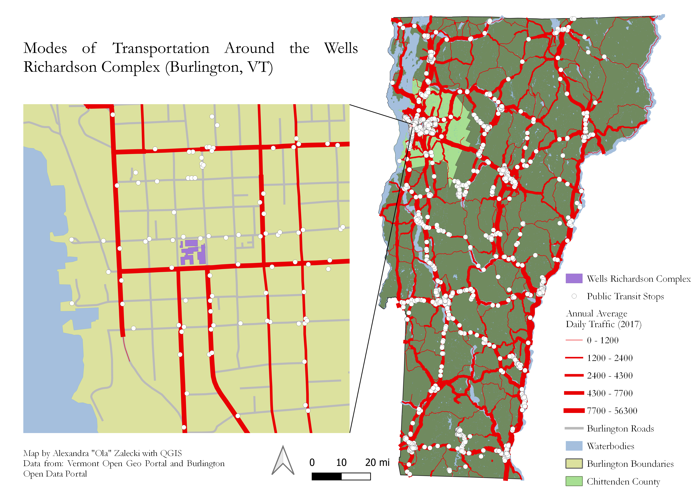
    
      <strong>How to get to the building</strong>
    
    </a>

  <a href="/assets/img/buildings/siteplan500updated.jpg"
     data-pswp-width="5500" data-pswp-height="4252" data-cropped="true"
     target="_blank">
    
    
      <strong>Site plan</strong>
    
  </a>

## Site Visit

### Structure

  <a href="/assets/img/buildings/front_street_view.jpg"
     data-pswp-width="960" data-pswp-height="720" data-cropped="true"
     target="_blank">
    
    
      <strong>View from across the street with other building faces visible</strong>
    
  </a>

  <a href="/assets/img/buildings/side_street_view.jpg"
     data-pswp-width="960" data-pswp-height="720" data-cropped="true"
     target="_blank">
    
    
      <strong>View from the St.Paul St and College St. Intersection</strong>  Pottery advert is mainly in view
    
   </a>
  <a href="/assets/img/buildings/front_facade.jpg"
     data-pswp-width="720" data-pswp-height="873" data-cropped="true"
     target="_blank">
    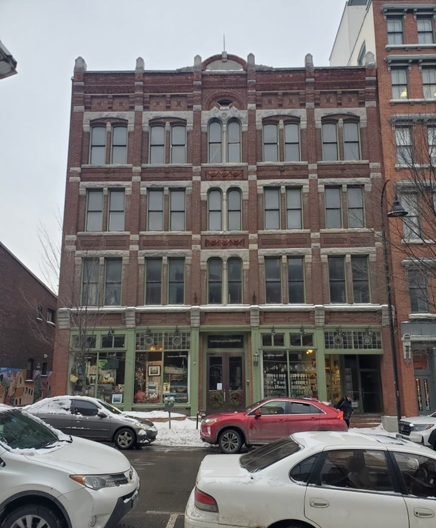
    
      <strong>Front Facade of the Wells-Richardson Building</strong>
    
    </a>
  <a href="/assets/img/buildings/viewshed.jpg"
     data-pswp-width="960" data-pswp-height="720" data-cropped="true"
     target="_blank">
    
    
      <strong>View from entrance</strong>
    
  </a>

  <a href="/assets/img/buildings/side_back_view.jpg"
     data-pswp-width="960" data-pswp-height="720" data-cropped="true"
     target="_blank">
    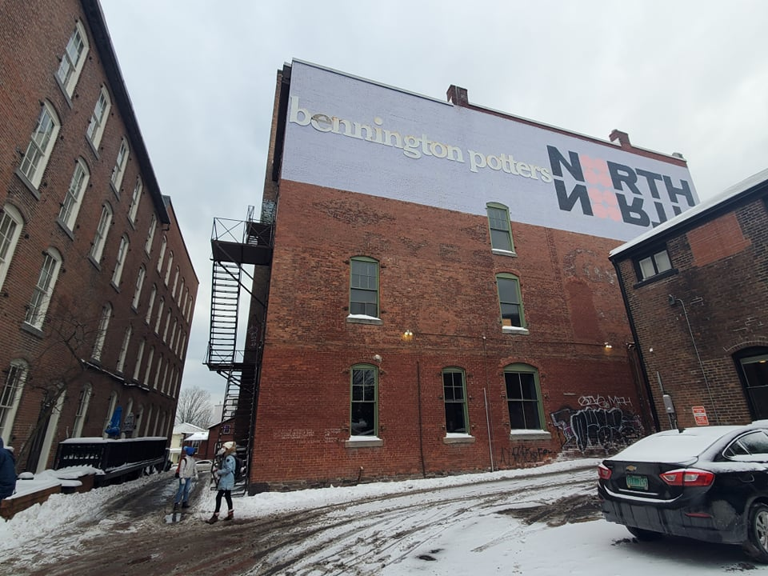
    
      <strong>Eastern side of the building with advert in closer view</strong>
    
  </a>

  <a href="/assets/img/buildings/side_back_view.jpg"
     data-pswp-width="960" data-pswp-height="720" data-cropped="true"
     target="_blank">
    
    
      <strong>Eastern side of the building with advert in closer view</strong>
    
  </a>

  <a href="/assets/img/buildings/back_from_corner.jpg"
     data-pswp-width="960" data-pswp-height="720" data-cropped="true"
     target="_blank">
    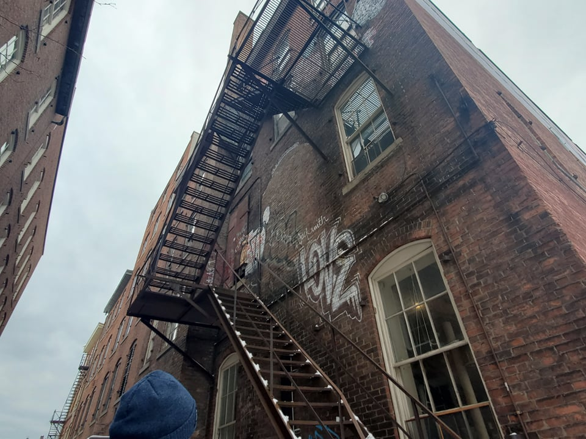
    
      <strong>Eastern side of the building with advert in closer view</strong>
    
  </a>

  <a href="/assets/img/buildings/below_back_view.jpg"
     data-pswp-width="960" data-pswp-height="720" data-cropped="true"
     target="_blank">
    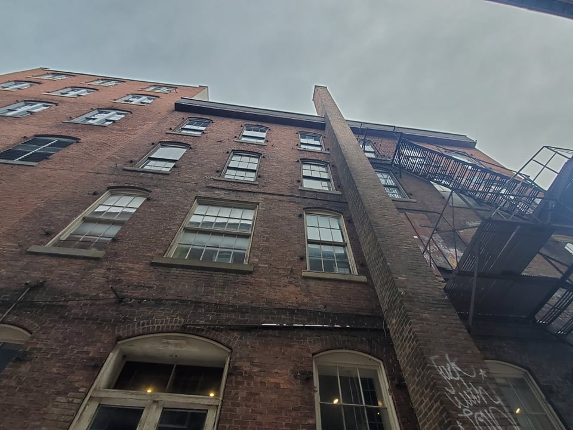
    
      <strong>Eastern side of the building with advert in closer view</strong>
    
  </a>

### Details
Lorem ipsum dolor sit amet, consectetur adipiscing elit. Ut vitae leo in velit posuere tristique. Vivamus vel imperdiet lectus, sit amet tincidunt neque. Mauris sodales augue odio, eu porta ipsum imperdiet a. Nulla euismod, leo quis cursus tempor, nulla tortor scelerisque leo, vitae vestibulum nunc velit vitae odio. Proin ac nibh tempor leo molestie pharetra. Vestibulum nisl dui, lobortis posuere purus quis, maximus euismod justo. Fusce id cursus sem, quis rutrum sem. Etiam eget dui vel dolor sagittis tempor a non ex. Nulla mauris justo, euismod id suscipit vel, porta et magna. Cras ac massa eu sem blandit ullamcorper. Quisque quis scelerisque dolor, vel porta erat. Integer vel massa a ipsum iaculis imperdiet non non est.

  <a href="/assets/img/buildings/sill_closeup.jpg"
     data-pswp-width="960" data-pswp-height="720" data-cropped="true"
     target="_blank">
    
    
      <strong>Sill (granite) with chipped off sides</strong>
    
  </a>

  <a href="/assets/img/buildings/graffitti.jpg"
     data-pswp-width="960" data-pswp-height="720" data-cropped="true"
     target="_blank">
    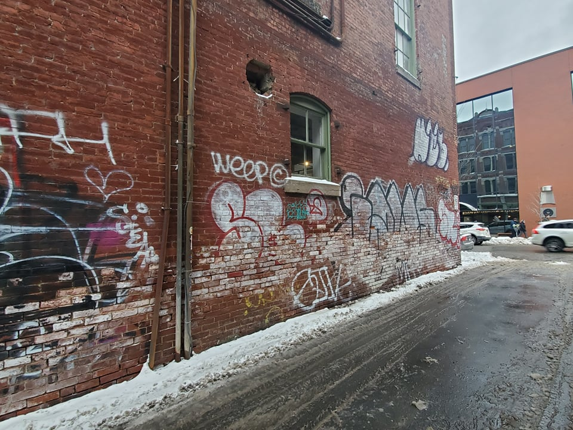
    
      <strong>Graffitti on exposed side of building (east)</strong>
    
    </a>

  <a href="/assets/img/buildings/disjoint_brick.jpg"
     data-pswp-width="720" data-pswp-height="873" data-cropped="true"
     target="_blank">
    
    
      <strong>Disjoint materials for foundation</strong>
    
    </a>

  <a href="/assets/img/buildings/chipping_brick.jpg"
     data-pswp-width="960" data-pswp-height="720" data-cropped="true"
     target="_blank">
    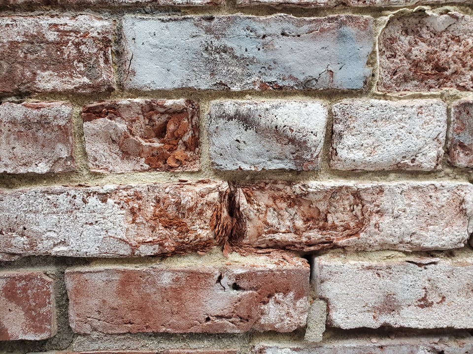
    
      <strong>Spalling</strong>  In certain parts of the eastern wall, brick was chipping. Most likely due to moisture saturating the brick.
    
  </a>

  <a href="/assets/img/buildings/brick_wood_close.jpg"
     data-pswp-width="960" data-pswp-height="720" data-cropped="true"
     target="_blank">
    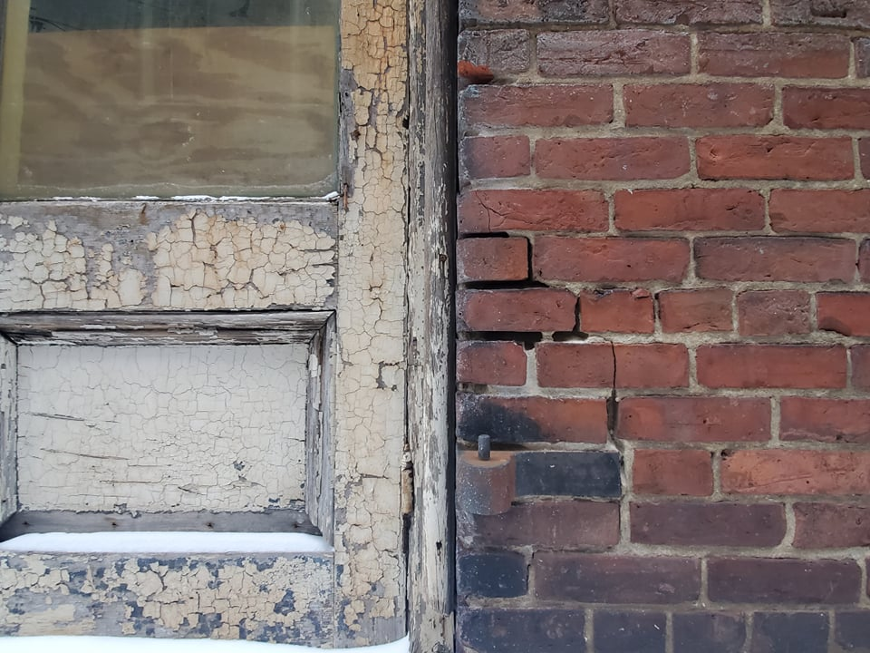
    
      <strong>Eastern side of the building with advert in closer view</strong>
    
  </a>

  <a href="/assets/img/buildings/side_back_view.jpg"
     data-pswp-width="960" data-pswp-height="720" data-cropped="true"
     target="_blank">
    
    
      <strong>Eastern side of the building with advert in closer view</strong>
    
  </a>

  <a href="/assets/img/buildings/birds_nest.jpg"
     data-pswp-width="720" data-pswp-height="960" data-cropped="true"
     target="_blank">
    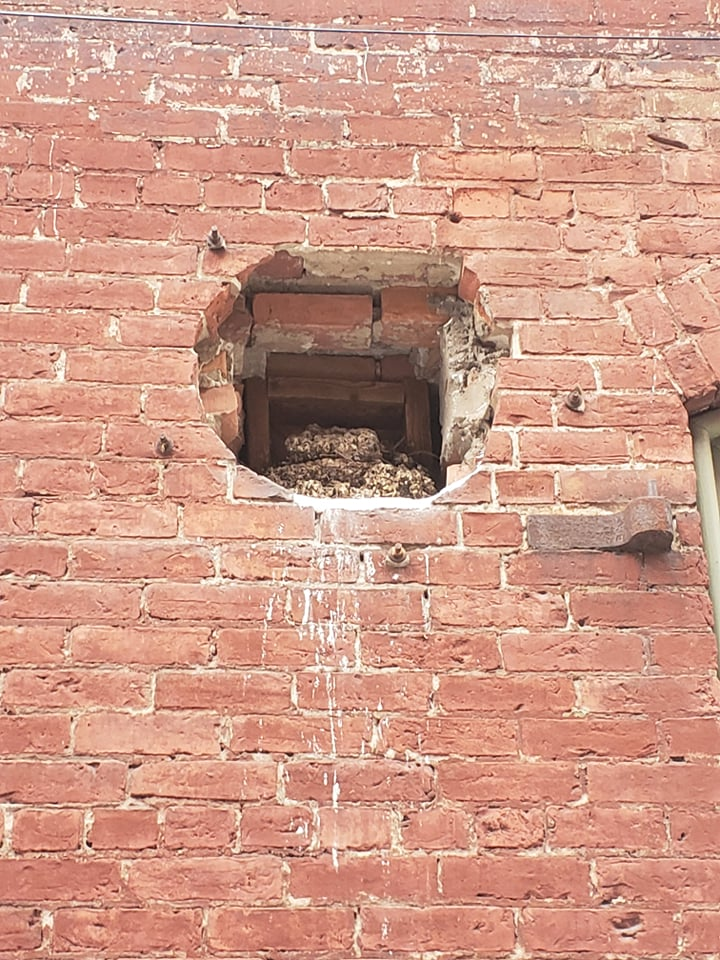
    
      <strong>A bird's home</strong>
    
  </a>

  <a href="/assets/img/buildings/closed_sign.jpg"
     data-pswp-width="720" data-pswp-height="960" data-cropped="true"
     target="_blank">
    
    
      <strong>A bird's home</strong>
    
  </a>

### Material Palette
Lorem ipsum dolor sit amet, consectetur adipiscing elit. Ut vitae leo in velit posuere tristique. Vivamus vel imperdiet lectus, sit amet tincidunt neque. Mauris sodales augue odio, eu porta ipsum imperdiet a. Nulla euismod, leo quis cursus tempor, nulla tortor scelerisque leo, vitae vestibulum nunc velit vitae odio. Proin ac nibh tempor leo molestie pharetra. Vestibulum nisl dui, lobortis posuere purus quis, maximus euismod justo. Fusce id cursus sem, quis rutrum sem. Etiam eget dui vel dolor sagittis tempor a non ex. Nulla mauris justo, euismod id suscipit vel, porta et magna. Cras ac massa eu sem blandit ullamcorper. Quisque quis scelerisque dolor, vel porta erat. Integer vel massa a ipsum iaculis imperdiet non non est.

### Sketches and Drawings

  <a href="/assets/img/buildings/stained_glass_sketch.jpeg"
     data-pswp-width="3103" data-pswp-height="1233" data-cropped="true"
     target="_blank">
    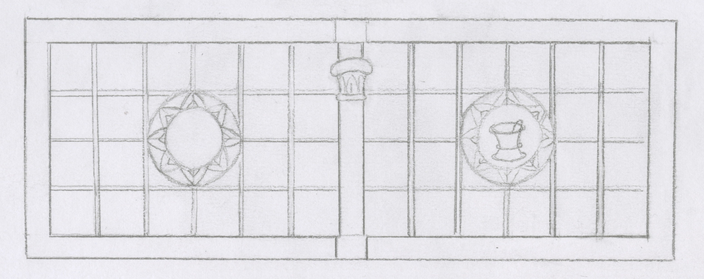
    
      <strong>Sketch of stained glass ornaments</strong>
    
    </a>

  <a href="/assets/img/buildings/facade_pencil.jpeg"
     data-pswp-width="960" data-pswp-height="720" data-cropped="true"
     target="_blank">
    
    
      <strong>Sill (granite) with chipped off sides</strong>
    
  </a>

  <a href="/assets/img/buildings/facade_watercolor.jpeg"
     data-pswp-width="814" data-pswp-height="956" data-cropped="true"
     target="_blank">
    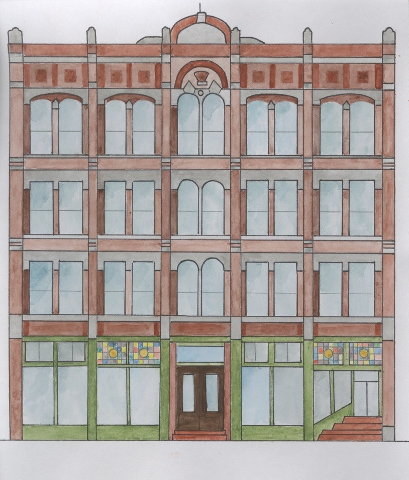
    
      <strong>Graffitti on exposed side of building (east)</strong>
    
    </a>

  <a href="/assets/img/buildings/mural_timeline.jpeg"
     data-pswp-width="1021" data-pswp-height="735" data-cropped="true"
     target="_blank">
    
    
      <strong>Changes of the eastern wall over time</strong>
    
    </a>

## Present 
Bennington Potters still occupies the building, although since the Covid-19 pandemic their doors have been closed. The building's continued closure has prompted [news articles](https://www.wcax.com/2025/03/27/bennington-potters-flagship-stores-remain-locked-5-years-after-pandemic/) and online discussions on forums like Facebook and Reddit questioning why. 

## Conclusion 
Overall, the building functions to provide College St with some immense character, charm, and history as it is an addition to the legendary Wells-Richardson Complex.

 