<link rel="stylesheet" href="https://unpkg.com/photoswipe@5/dist/photoswipe.css">
<link rel="stylesheet" href="https://unpkg.com/photoswipe-dynamic-caption-plugin/photoswipe-dynamic-caption-plugin.css">

## Intro to the Project
During a month-long program of study in the winter of 2022, I explored Burlington, VT, through the lens of a single building: the Wells-Richardson Building at 127 College Street. I researched its history, represented it graphically through drawings and photos, and studied it in relation to its larger geography in order to answer the questions: "How has the building 'learned' over time" and 
"What social and economic histories are inscribed in its local landscape?"

  <a href="/assets/img/buildings/building_google.png"
     data-pswp-width="925" data-pswp-height="723" data-cropped="true"
     target="_blank">
    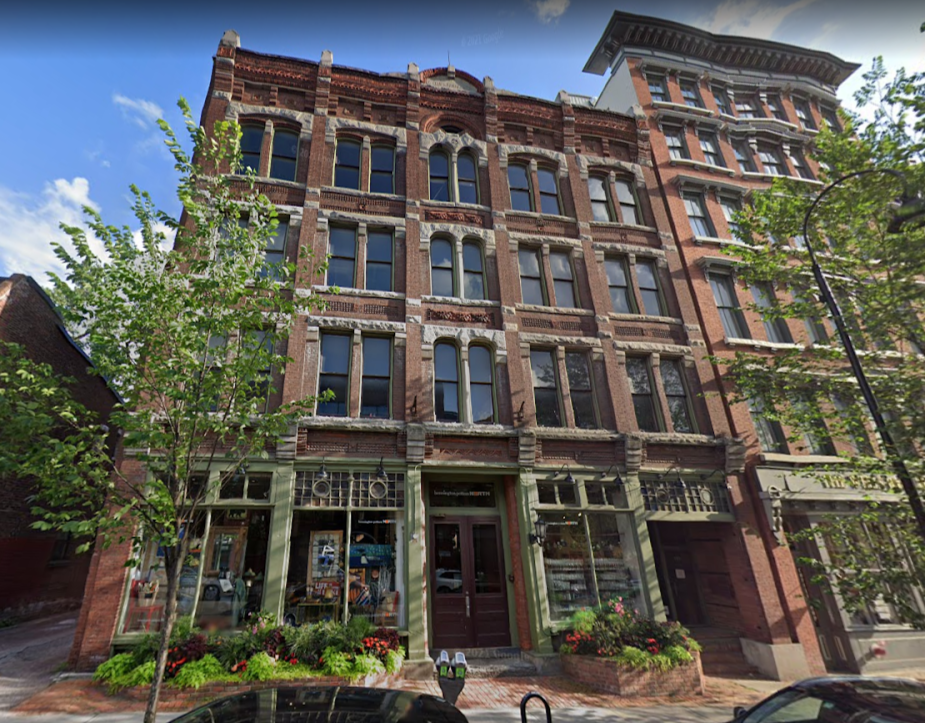
    
      <strong>Wells Richardson Building as seen on Google Maps Streetview</strong>
    
  </a>

 

### Why the Wells-Richardson Building 
* Connected to Burlington's industrial history
* Central location in the city
* Part of a wider “system”/complex of buildings
* Its visual aesthetic: red brick, tall, decorative elements

## A little more about the building 

The Wells-Richardson building was constructed in 1883 with the intention of serving as Wells-Richardson Co.'s new main laboratory and offices. One of several buildings within the Wells-Richardson Complex, the new structure was an "upgrade" from 126 College St. Annotations in Burlington’s Sanborn Fire Insurance maps (1885–1912) indicate that the building’s four floors contained a chemical laboratory, storage space, boxing and packing areas, a mixing area, a package-labeling area, and an advertising office. 

  <a href="/assets/img/buildings/complex_map.png"
      data-pswp-width="658" data-pswp-height="830" data-cropped="true"
     target="_blank">
    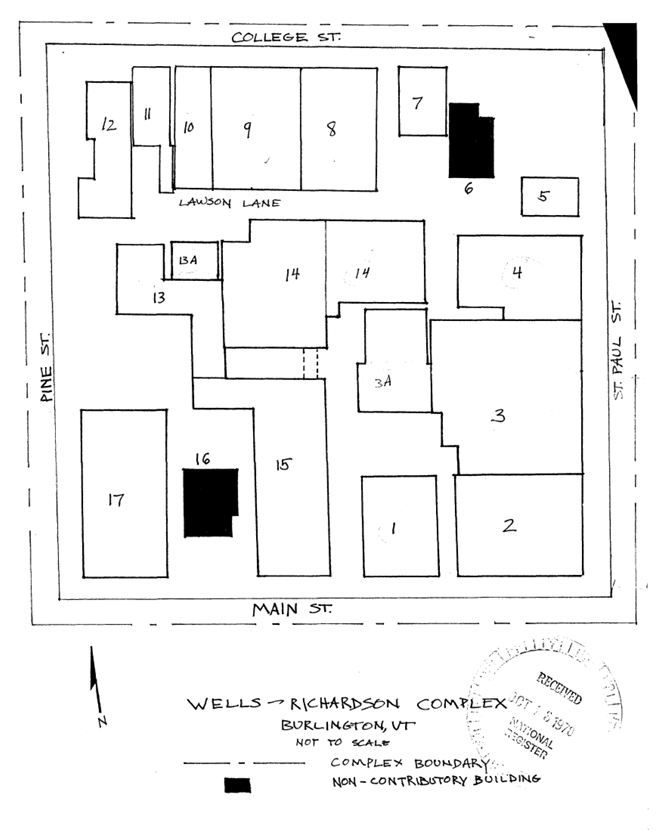
    
      <strong>Map of the Wells Richardson Complex appended to it's nomination into the National Register of Historic Places.</strong> 
      The Wells Richardson Building is number 8 in this map. 
    
  </a>

  <a href="/assets/img/buildings/sanborn.png"
      data-pswp-width="1200" data-pswp-height="1478" data-cropped="true"
     target="_blank">
    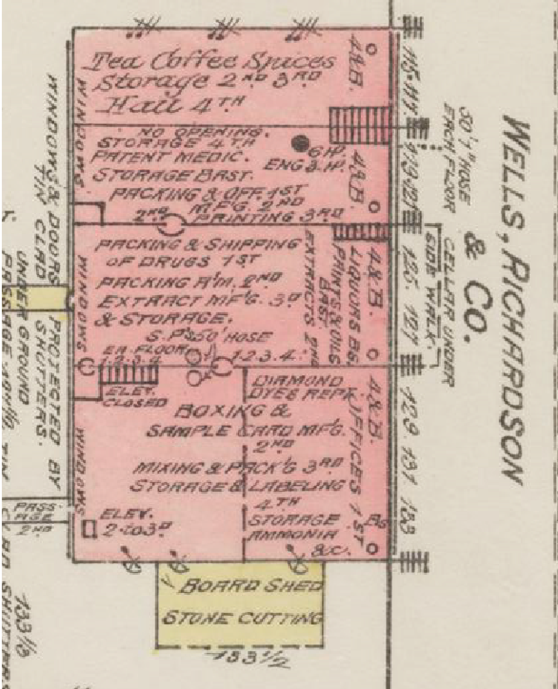
    
      <strong>Screenshot from 1885 Sanborn Map.</strong>
    

  <a href="/assets/img/buildings/print_wells_old.png"
     data-pswp-width="459" data-pswp-height="500" data-cropped="true"
     target="_blank">
    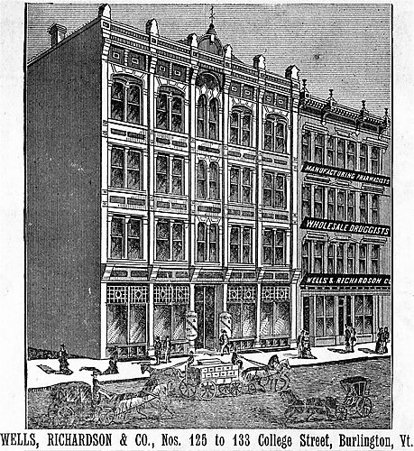
    
      <strong>print of wells richardson</strong>
    
  </a>

  <a href="/assets/img/buildings/126_college_st.png"
     data-pswp-width="700" data-pswp-height="1125" data-cropped="true"
     target="_blank">
    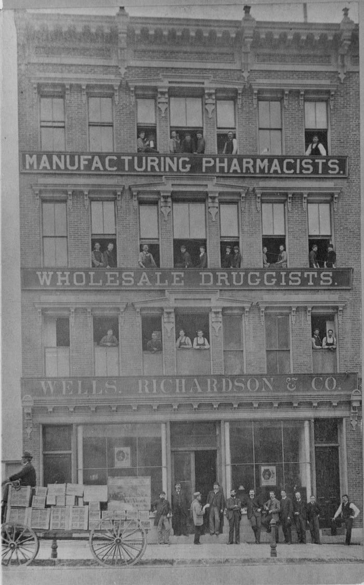
    
      <strong>126 College St. </strong>
    
  </a>

 

A.B. Fisher is the mind behind the building’s design. As the most renowned architect in Burlington at the time (1880s), Fisher was contracted to build across the city. Some other well-known buildings in his portfolio include [the Howard Chapel](https://www.preservationburlington.org/historic-properties/howard-chapel), [the Ethan Allen Engine Company](https://sah-archipedia.org/buildings/VT-01-CH31), and [the Willard Inn](https://www.uvm.edu/~hp206/2004-1890/burlington1890/website/agodat/349sw.html).

What he built for Wells-Richardson Co. is a four story building built in the High Italianite style with a footprint that measures approximately 5151 square feet. Its richly embelished exterior is what sets it apart from the other buildings on the street.

When being nominated into the National Register of Historic Places, this detailing is explicity documented as grounds for it preservation:

“Five bays, each with paired windows framed by rock-faced granite lintels and sills, are spaced across the facade on each floor, divided by brick pilasters with granite caps. Other detailing includes the use of various kinds of arches throughout the fenestration, terra cotta and brick panels in the spandrels, an elaborately corbeled cornice constructed of shaped brick and terra cotta, and granite finials placed atop the series of pilasters, between the center two of which is a panel with lettering which reads ‘1883 Wells & Richardson.’ The ground floor bays have brick corner piers, cast iron posts, plate glass windows with wood muntins and stained glass transom lights.”

Built during the height of Wells-Richardson Co's commercial success and Burlington's rise into a booming industrial hub, I believe the embellishments were purposeful. Fisher most likley wanted to capture the prosperity of his client and contribute to the beautification of a city seeing rapid urban change. 

## Building's Inhabitants

The first inhabitant and the buildings namesake, the Well-Richardson company was one of the nation’s largest wholesale drug and dye companies. At the company's peak, Wells and Richardson were reaching at least 2 million dollars in annual sales (around 51 million today). In Burlington, they employed more than 200 people at its manufacturing plant but also had branches overseas in Montreal, London, and Sydney.

  <a href="/assets/img/buildings/wells_office.jpg" 
      data-pswp-width="536" data-pswp-height="480" data-cropped="true"
     target="_blank">
    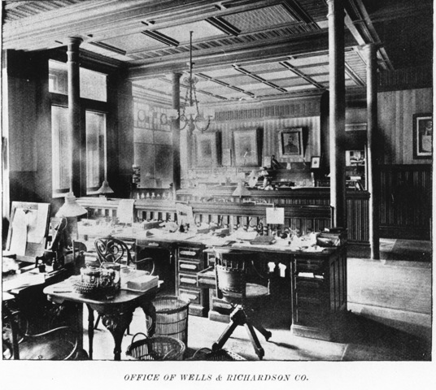
    
      <strong>Interior view of the first floor of the Wells & Richardson Building.</strong> 
      Photo taken by Louis L. McAllister (undated). Found in the UVM Library, Special Collections.
    
    </a>

  <a href="/assets/img/buildings/bottling.jpeg" 
      data-pswp-width="516" data-pswp-height="381" data-cropped="true"
     target="_blank">
    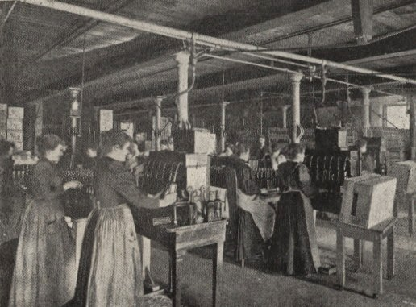
    
      <strong>Women bottling.</strong> 
      Photo taken idk
    
    </a>

 They were so successful in part due to their aggressive marketing strategies distributing free samples, product ads, and consumer testimonials. Wells-Richardson Co. even took advantage of the bare exteriors of their buildings, painting the eastern wall of 127 College St in murals advertising their products. 
 

 

   <a href="/assets/img/buildings/wells_from_book.png"
     data-pswp-width="903" data-pswp-height="960" data-cropped="true"
     target="_blank">
    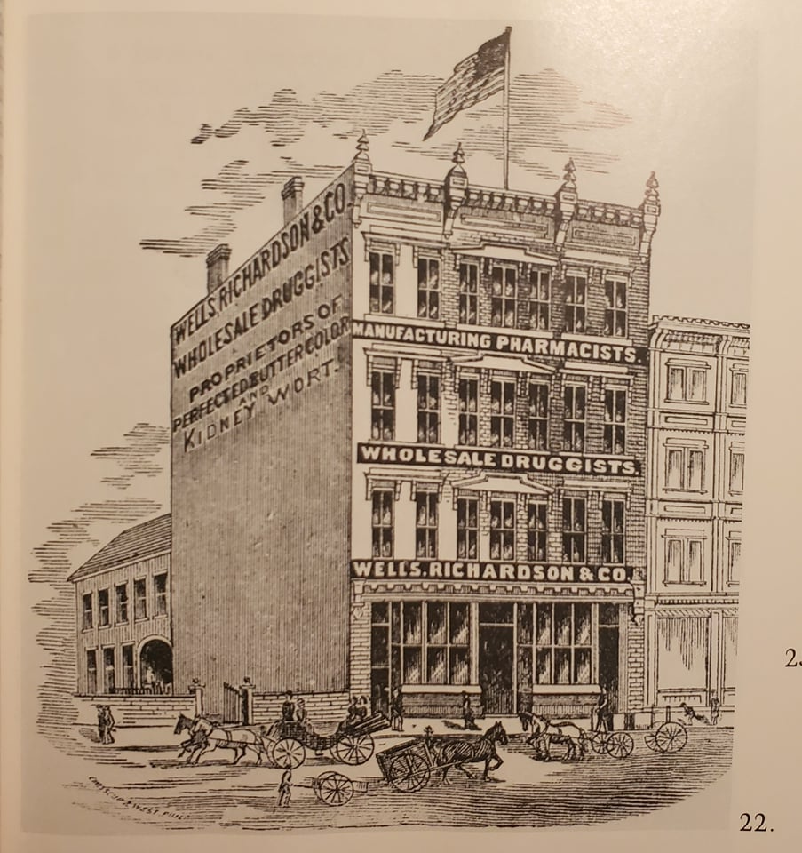
    
      <strong>wells richardson building from book</strong>
    
  </a>

   <a href="/assets/img/buildings/mural_02.jpg"
     data-pswp-width="799" data-pswp-height="540" data-cropped="true"
     target="_blank">
    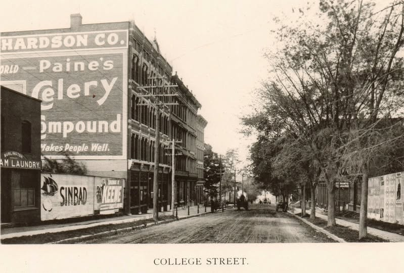
    
      <strong>Wells Richardson building from book</strong>
    
  </a>

 The building remained under Wells-Richardson Co. for almost three decades before the company was doomed to stricter federal regulations on patent medicines after the passing of the Pure Food and Drug Act in 1906.
 

The Burlington Daily News would follow as the building’s next inhabitants from the 1940s-1970s.

  <a href="/assets/img/buildings/news_building.png" 
      data-pswp-width="730" data-pswp-height="500" data-cropped="true"
     target="_blank">
    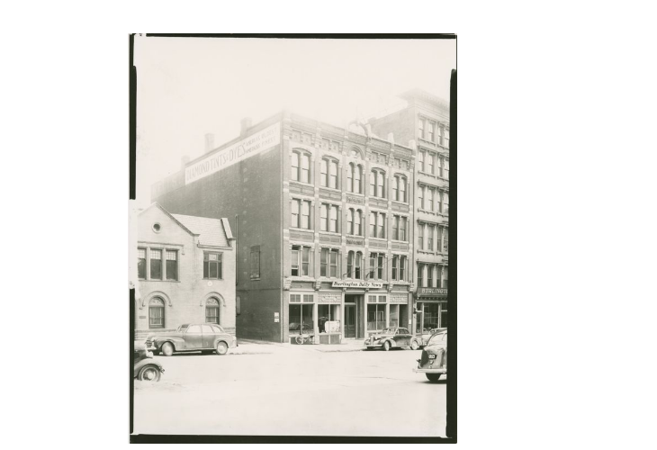
    
      <strong>Wells Richardson Building, College Street. Location of the Burlington Daily News.</strong> 
      Photo taken by Louis L. McAllister (1946/1947). Found in the UVM Library, Special Collections.
    
    </a>

  <a href="/assets/img/buildings/newsies.png" 
      data-pswp-width="730" data-pswp-height="500" data-cropped="true"
     target="_blank">
    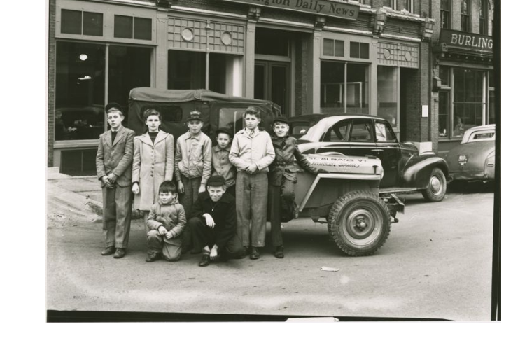
    
      <strong>Child paper carriers stand beside a car in front of the Wells Richardson Building.</strong> 
      Photo taken by Louis L. McAllister (1946/1947). Found in the UVM Library, Special Collections.
    
    </a>

 
In 1973, it was finally acquired by Bennington Potters to house their flagship store: Bennington Potters North, Inc. 
It was in this decade(1979) that the Wells Richardson Complex also joined the National Register of Historic Buildings. 

  <a href="/assets/img/buildings/building_north_mural.png" 
      data-pswp-width="1232" data-pswp-height="868" data-cropped="true"
     target="_blank">
    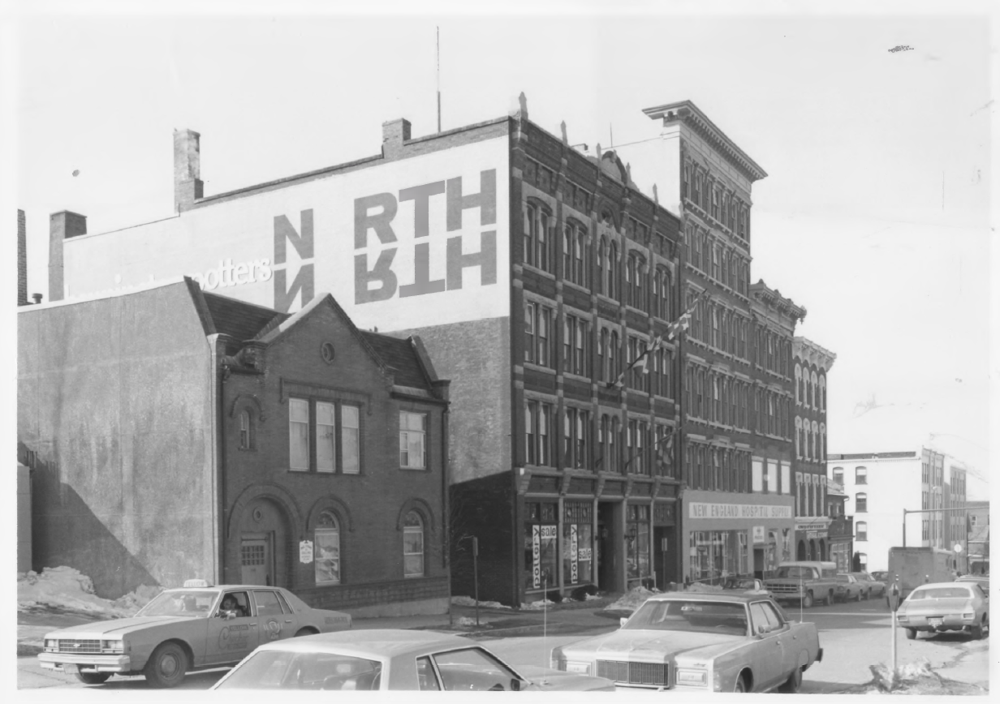
    
      <strong>Wells Richardson Building, College Street. Location of the Burlington Daily News.</strong> 
      Photo taken by Louis L. McAllister (1946/1947). Found in the UVM Library, Special Collections.
    
    </a>

  <a href="/assets/img/buildings/full_street_facade.png" 
      data-pswp-width="903" data-pswp-height="677" data-cropped="true"
     target="_blank">
    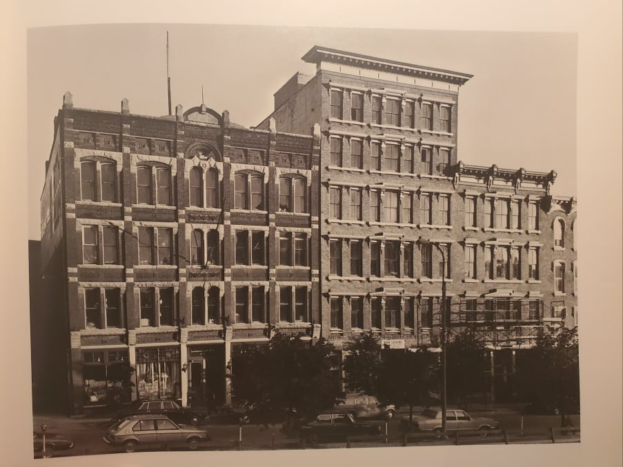
    
      <strong>Child paper carriers stand beside a car in front of the Wells Richardson Building.</strong> 
      Photo taken by Louis L. McAllister (1946/1947). Found in the UVM Library, Special Collections.
    
    </a>

## Modifications 

For almost a century, no significant changes had been done to the building itself until Bennington Potters renovated the interior. There was apparently a fire at some point that almost destroyed the first floor (but no documentation of how it was patched up after). As time progressed and standards changed, I assume that the building acquired contemporary electrical, plumbing, HVAC, etc. Otherwise, the only substantial documented changes to the building happened in the 1970s when Bennington Potters renovated the interior of the building.

The first three floors became converted into a retail space with the addition of a large stairwell to unify the three floors. The back portion of the first floor was lowered, and the interior walls were removed to reveal the brick exterior walls. Due to the building’s age, there was also the need for added structural security and other safety concerns. Therefore, steel columns were added (to mimic the cast iron ones), a fireproof exit core, a restored fire escape, and a sprinkler system. According to the writers of The Burlington Book, the renovation of the Wells-Richardson Building was quite an achievement and a great example of a “successful reuse of a historic commercial building in downtown Burlington.” No changes have been made to the front facade of the building other than minor restoration efforts. The eastern wall, however, which has served as a mural space for decades, did get an upgrade. The mural now advertises Bennington Potters North, Inc., the official company name of the retail space for Bennington Potters.

  <a href="/assets/img/buildings/potters_interior.jpg"
     data-pswp-width="1496" data-pswp-height="2048" data-cropped="true"
     target="_blank">
    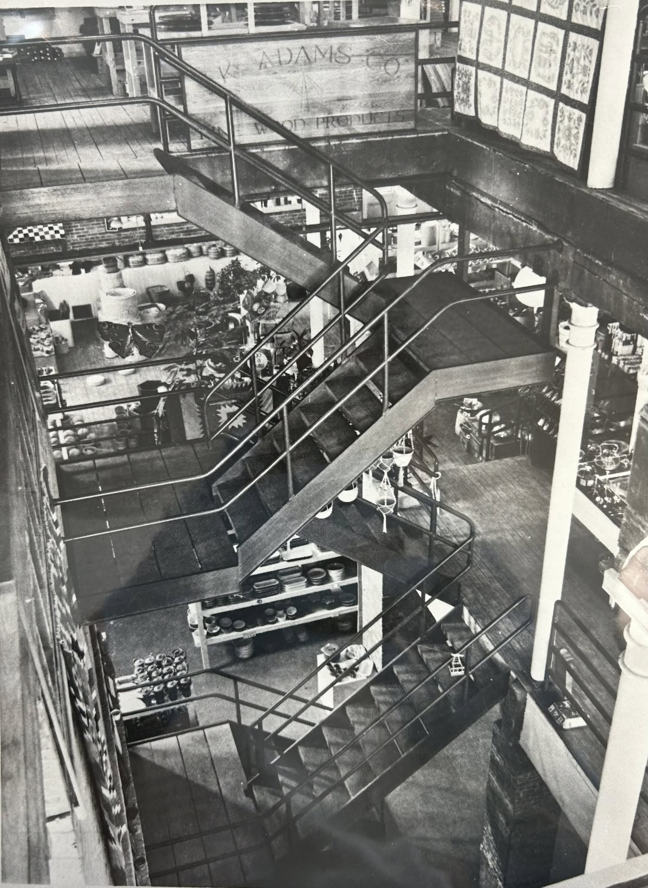
    
      <strong>How to get to the building</strong>
    
    </a>

## Site Visit
 

### Structure

  <a href="/assets/img/buildings/front_street_view.jpg"
     data-pswp-width="960" data-pswp-height="720" data-cropped="true"
     target="_blank">
    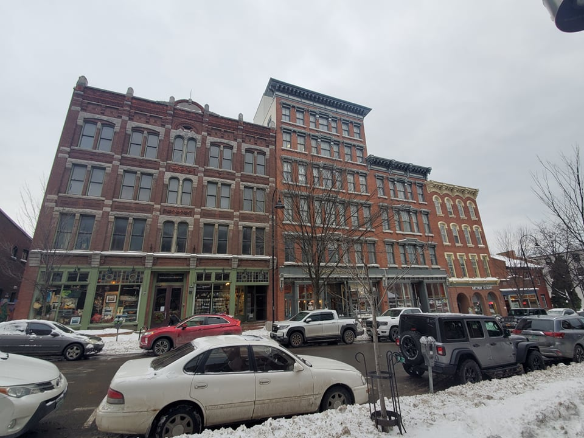
    
      <strong>View from across the street with other building faces visible</strong>
    
  </a>

  <a href="/assets/img/buildings/side_street_view.jpg"
     data-pswp-width="960" data-pswp-height="720" data-cropped="true"
     target="_blank">
    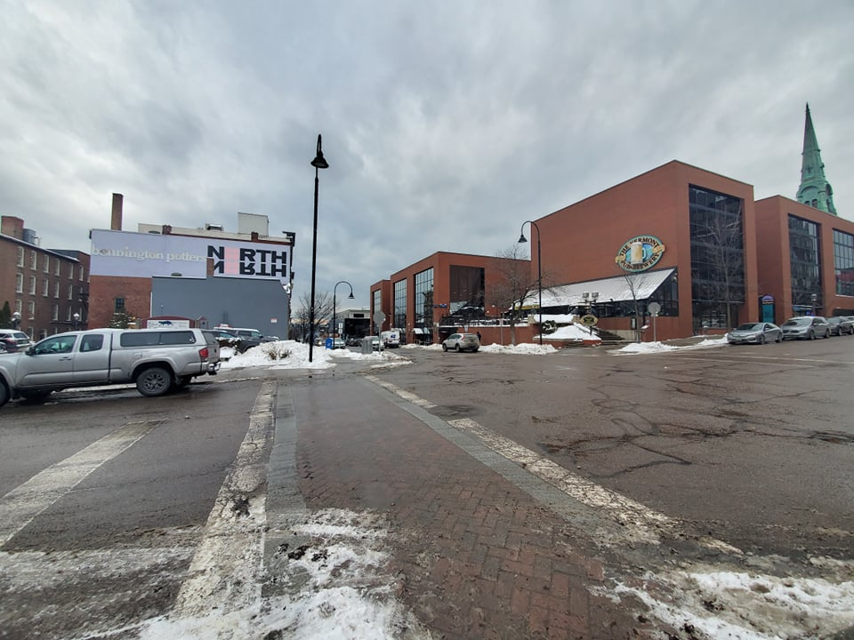
    
      <strong>View from the St.Paul St and College St. Intersection</strong>  Pottery advert is mainly in view
    
   </a>
  <a href="/assets/img/buildings/front_facade.jpg"
     data-pswp-width="720" data-pswp-height="873" data-cropped="true"
     target="_blank">
    
    
      <strong>Front Facade of the Wells-Richardson Building</strong>
    
    </a>
  <a href="/assets/img/buildings/viewshed.jpg"
     data-pswp-width="960" data-pswp-height="720" data-cropped="true"
     target="_blank">
    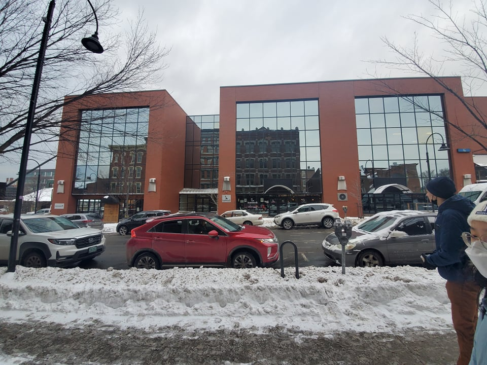
    
      <strong>View from entrance</strong>
    
  </a>

  <a href="/assets/img/buildings/side_back_view.jpg"
     data-pswp-width="960" data-pswp-height="720" data-cropped="true"
     target="_blank">
    
    
      <strong>Eastern side of the building with advert in closer view</strong>
    
  </a>

  <a href="/assets/img/buildings/side_back_view.jpg"
     data-pswp-width="960" data-pswp-height="720" data-cropped="true"
     target="_blank">
    
    
      <strong>Eastern side of the building with advert in closer view</strong>
    
  </a>

  <a href="/assets/img/buildings/back_from_corner.jpg"
     data-pswp-width="960" data-pswp-height="720" data-cropped="true"
     target="_blank">
    
    
      <strong>Eastern side of the building with advert in closer view</strong>
    
  </a>

  <a href="/assets/img/buildings/below_back_view.jpg"
     data-pswp-width="960" data-pswp-height="720" data-cropped="true"
     target="_blank">
    
    
      <strong>Eastern side of the building with advert in closer view</strong>
    
  </a>

### Details

  <a href="/assets/img/buildings/sill_closeup.jpg"
     data-pswp-width="960" data-pswp-height="720" data-cropped="true"
     target="_blank">
    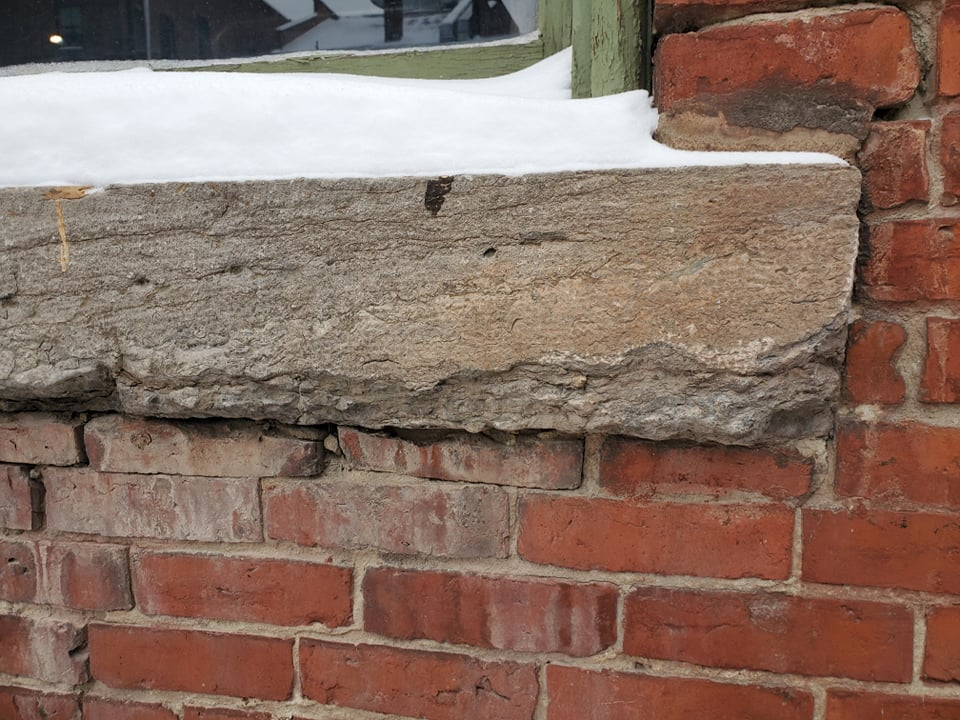
    
      <strong>Sill (granite) with chipped off sides</strong>
    
  </a>

  <a href="/assets/img/buildings/graffitti.jpg"
     data-pswp-width="960" data-pswp-height="720" data-cropped="true"
     target="_blank">
    
    
      <strong>Graffitti on exposed side of building (east)</strong>
    
    </a>

  <a href="/assets/img/buildings/disjoint_brick.jpg"
      data-pswp-width="960" data-pswp-height="720" data-cropped="true"
     target="_blank">
    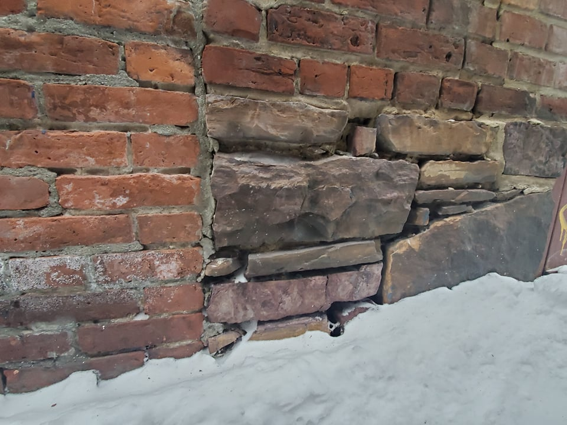
    
      <strong>Disjoint materials for foundation</strong>
    
    </a>

  <a href="/assets/img/buildings/chipping_brick.jpg"
     data-pswp-width="960" data-pswp-height="720" data-cropped="true"
     target="_blank">
    
    
      <strong>Spalling</strong>  In certain parts of the eastern wall, brick was chipping. Most likely due to moisture saturating the brick.
    
  </a>

  <a href="/assets/img/buildings/brick_wood_close.jpg"
     data-pswp-width="960" data-pswp-height="720" data-cropped="true"
     target="_blank">
    
    
      <strong>Eastern side of the building with advert in closer view</strong>
    
  </a>

  <a href="/assets/img/buildings/side_back_view.jpg"
     data-pswp-width="960" data-pswp-height="720" data-cropped="true"
     target="_blank">
    
    
      <strong>Eastern side of the building with advert in closer view</strong>
    
  </a>

  <a href="/assets/img/buildings/birds_nest.jpg"
     data-pswp-width="720" data-pswp-height="960" data-cropped="true"
     target="_blank">
    
    
      <strong>A bird's home</strong>
    
  </a>

### Material Palette
 
Lorem ipsum dolor sit amet, consectetur adipiscing elit. Ut vitae leo in velit posuere tristique. 

### Maps
 

  <a href="/assets/img/buildings/BurlingtonTransit_final.png"
     data-pswp-width="3507" data-pswp-height="2480" data-cropped="true"
     target="_blank">
    
    
      <strong>How to get to the building</strong>
    
    </a>

  <a href="/assets/img/buildings/siteplan500updated.jpg"
     data-pswp-width="5500" data-pswp-height="4252" data-cropped="true"
     target="_blank">
    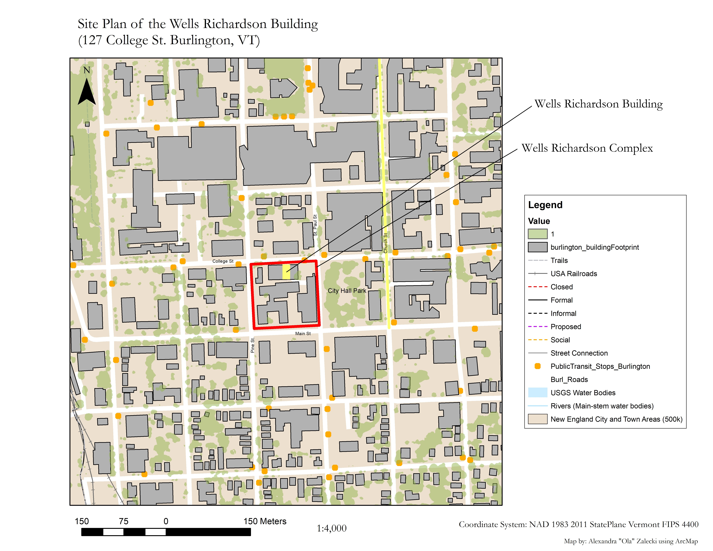
    
      <strong>Site plan</strong>
    
  </a>

### Sketches and Drawings
 

  <a href="/assets/img/buildings/stained_glass_sketch.jpeg"
     data-pswp-width="3103" data-pswp-height="1233" data-cropped="true"
     target="_blank">
    
    
      <strong>Sketch of stained glass ornaments</strong>
    
    </a>

  <a href="/assets/img/buildings/facade_pencil.jpeg"
      data-pswp-width="3511" data-pswp-height="4116" data-cropped="true"
     target="_blank">
    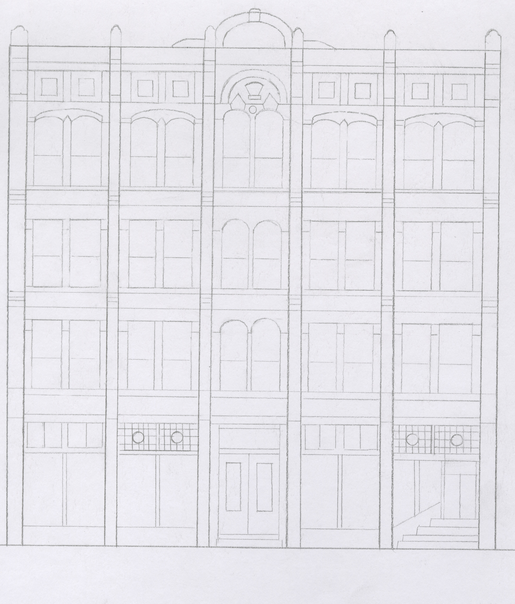
    
      <strong>Sill (granite) with chipped off sides</strong>
    
  </a>

  <a href="/assets/img/buildings/facade_watercolor.jpeg"
     data-pswp-width="814" data-pswp-height="956" data-cropped="true"
     target="_blank">
    
    
      <strong>Graffitti on exposed side of building (east)</strong>
    
    </a>

  <a href="/assets/img/buildings/mural_timeline.jpeg"
     data-pswp-width="1021" data-pswp-height="735" data-cropped="true"
     target="_blank">
    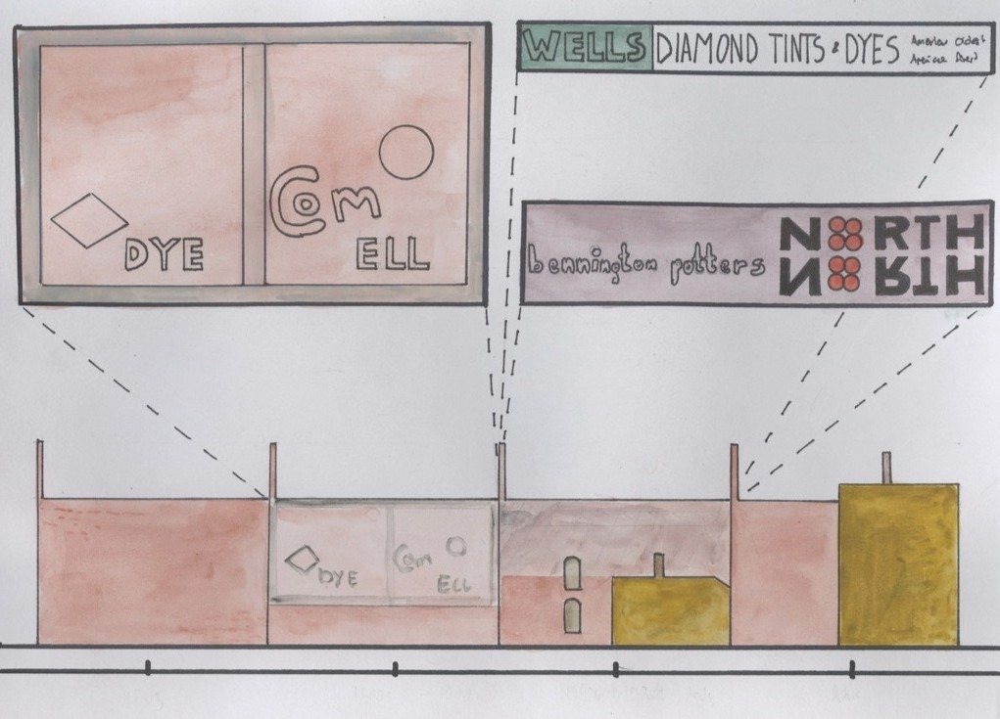
    
      <strong>Changes of the eastern wall over time</strong>
    
    </a>

  <a href="/assets/img/buildings/closed_sign.jpg"
     data-pswp-width="720" data-pswp-height="960" data-cropped="true"
     target="_blank">
    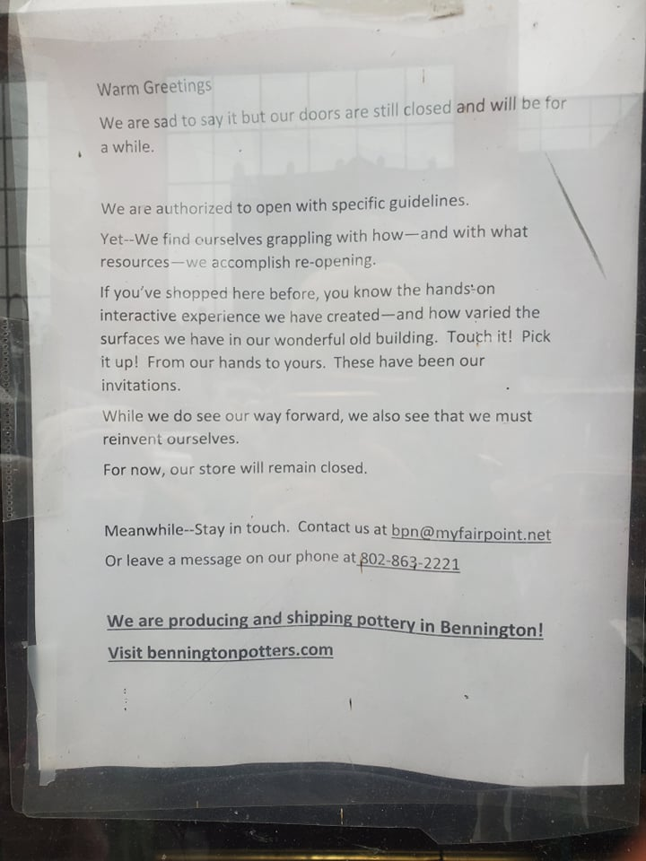
    
      <strong>A bird's home</strong>
    
  </a>

 

## Present 
Unfortunately, during my site visit I was unable to go into the building as it has been closed since the onset of the Covid-19 pandemic. That was 2022. As of 2026, when I revisted this project, the Benning Potters North store is still closed!

After some investigation online, I found that the building's continued closure has prompted [news articles](https://www.wcax.com/2025/03/27/bennington-potters-flagship-stores-remain-locked-5-years-after-pandemic/) and online discussions on forums like Facebook and Reddit questioning why. There has been no update to the signage on the door or any sign of Bennington Potter's opening its doors anytime soon. 

## Conclusion 
Overall, the building functions to provide College St with some immense character, charm, and history as it is an addition to the legendary Wells-Richardson Complex.

 